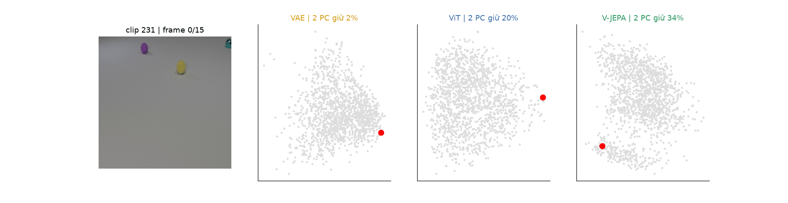
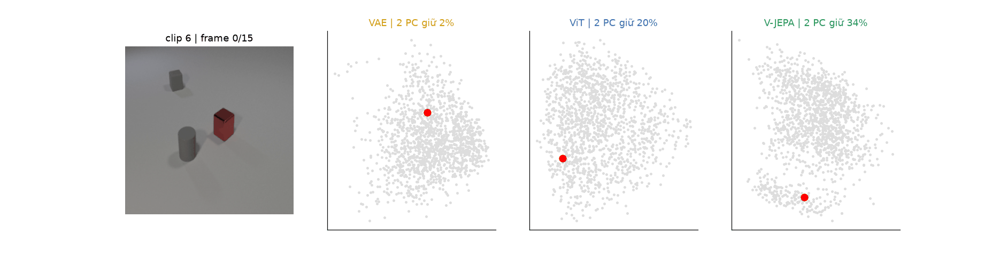
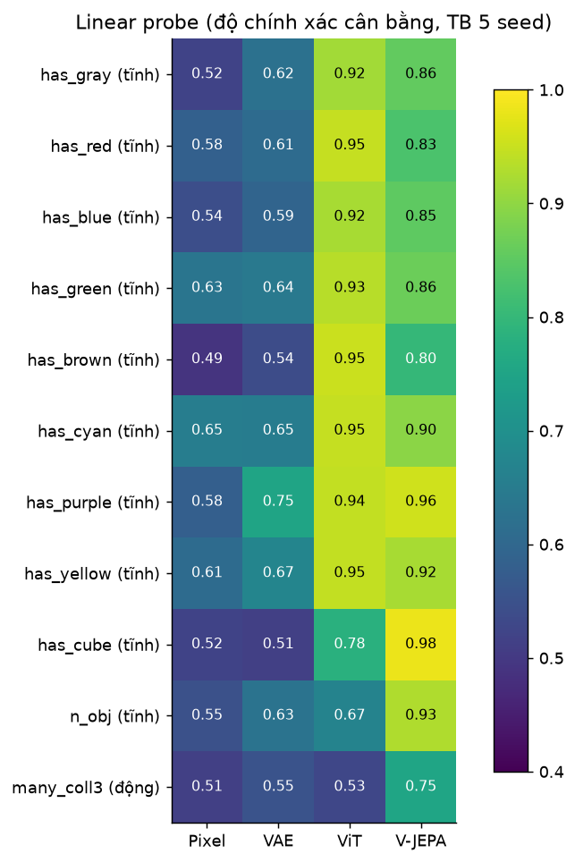
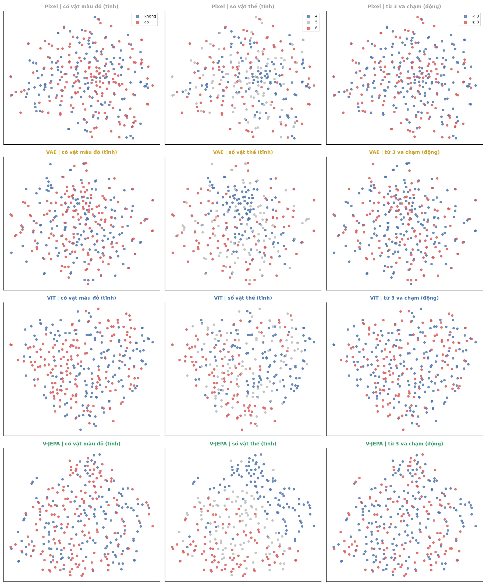
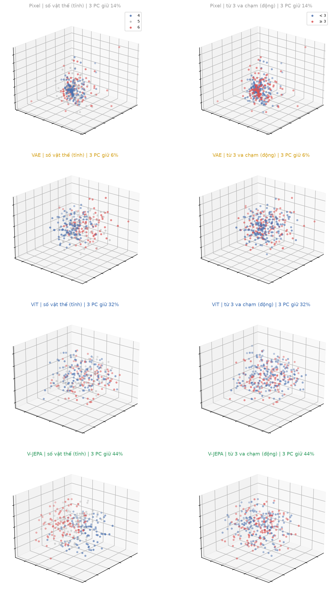
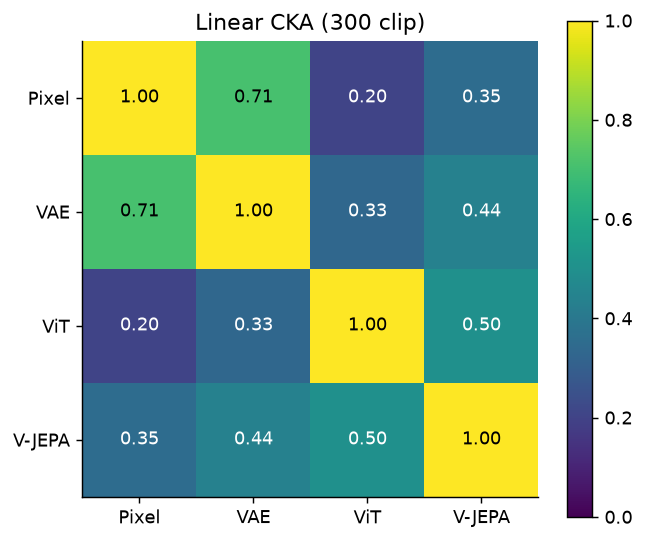
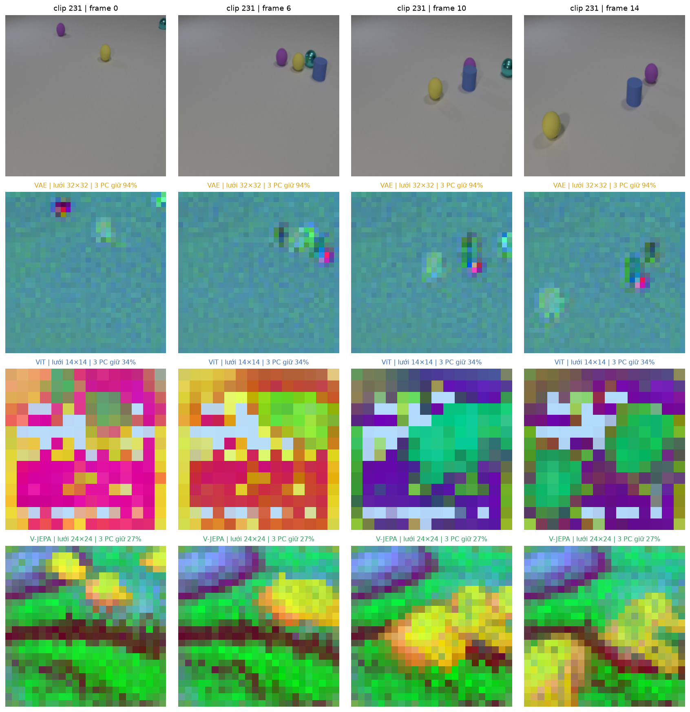

<div align="center">

[🇬🇧 English](README.md) • [🇻🇳 Tiếng Việt](README_VI.md)

</div>

# 🧠 WorldModel Representation Benchmark: VAE vs. ViT vs. V-JEPA on CLEVRER

[](https://www.python.org/downloads/)
[](https://pytorch.org/)
[](LICENSE)
[](http://clevrer.csail.mit.edu/)
[]()

> **An In-Depth Empirical Benchmark on Visual State-Space Representations for World Models**  
> *Author:* **Louis Dang Khoa** (`ID: 2510905`)

---

## 📌 Executive Summary

In autonomous **World Models**, selecting the visual state representation space $S$ is foundational to how agents simulate physics, predict downstream futures, and perform counterfactual reasoning. 

This project conducts an exhaustive comparative benchmark across three distinct pretraining paradigms—all evaluated under **frozen backbone weights**—alongside a **Raw Pixel** baseline (zero-learning control), on the challenging **CLEVRER** (*Collision Events for Video REpresentation and Reasoning*) benchmark:

1. **VAE (AutoencoderKL / Pixel Reconstruction):** Low-level compression trained to reconstruct high-resolution 2D pixel fields.
2. **ViT (Supervised Vision Transformer):** High-level static semantics trained via 2D supervised image classification (ImageNet).
3. **V-JEPA (Video Joint Embedding Predictive Architecture):** Self-supervised predictive representation learning over masked spatio-temporal 3D tubelets without pixel decoding.

```
                                  ┌───► VAE    (2D Pixel Reconstruction)       ───► S_VAE    ┐
Video clip X (16 frames, 4s) ─────┼───► ViT    (2D Supervised Classification)  ───► S_ViT    ├───► Visual Diagnostics (t-SNE/PCA) ───► Probing & CKA
     (CLEVRER Dataset)            └───► V-JEPA (3D Masked Latent Prediction)   ───► S_VJEPA ┘
                                                +
                                      Raw Pixel (Control Baseline)
```

---

## 📊 Comprehensive Empirical Benchmark Matrix

Quantitative results evaluated directly on identical video sequences, extracted from `outputs/summary.csv`:

| Evaluation Metric | Raw Pixel | VAE (KL-f8) | ViT (Base) | V-JEPA 2 (ViT-L/16) | Key Scientific Takeaway |
|:---|:---:|:---:|:---:|:---:|:---|
| **State Dimension ($S$)** | 3,072 | 4,096 | 768 | 1,024 | Latent compactness & compression ratio |
| **Probe: Color (Mean over 8 colors)** | 57.7% | 63.5% | **93.9%** | 87.2% | ViT excels at static/surface-level appearance |
| **Probe: 3D Geometry (Cube Shape)** | 52.0% | 51.3% | 78.2% | **98.2%** | V-JEPA exhibits near-perfect 3D geometric grounding |
| **Probe: Object Count ($\hat{N}$)** | 54.9% | 62.8% | 66.9% | **92.9%** | V-JEPA disentangles multi-object compositional scenes |
| **Probe: Collisions ($\ge 3$ events)** | 51.4% | 55.4% | 52.7% | **75.2%** | V-JEPA captures complex multi-body physical collisions |
| **Collisions (Controlled Object Count)** | 48.8% | 52.3% | 53.1% | **66.5%** | Robust collision detection invariant to scene density |
| **Arrow of Time (Forward vs. Reverse)** | — | 50.0% | 50.0% | **97.5%** | **Breakthrough:** VAE & ViT collapse to chance level (50%); V-JEPA preserves temporal directionality |
| **CKA Similarity with Raw Pixels** | 1.00 | **0.71** | 0.20 | 0.35 | VAE retains excessive surface-level pixel correlation |
| **Top-2 PCA Explained Variance** | 10.3% | 4.8% | 24.6% | **35.6%** | V-JEPA forms a well-structured, low-dimensional manifold |
| **Parameter Count (M)** | 0 | 83.7M | 85.8M | 304.7M | Model complexity |
| **Inference Latency (sec / clip)** | — | 2.51s | **0.73s** | 5.46s | Feature extraction throughput on GPU |
| **Peak VRAM Consumption (GB)** | — | 1.02 GB | **0.50 GB** | 1.54 GB | Hardware footprint during inference |

---

## 🔬 Core Scientific Findings

### 1. The Arrow of Time & Causal Grounding
- **The Collapse of Frame-Based Models:** Both VAE and ViT achieve exactly **50.0%** accuracy on the forward-versus-reverse video probe (indistinguishable from a coin flip). Because they encode frames independently, they are fundamentally blind to the physical arrow of time.
- **Spatio-Temporal Predictive Encoding:** V-JEPA achieves **97.5%**, demonstrating that predicting masked future/past tubelets forces the model to encode causal momentum, velocity, and irreversible physical interactions.

### 2. Physical Collision Dynamics vs. Scene Confounders
- Under dense multi-collision scenarios ($\ge 3$ collisions), V-JEPA delivers **75.2%** linear probe accuracy, outperforming ViT (52.7%) and VAE (55.4%) by over 20%.
- When rigorously controlling for object count to eliminate spurious correlations, V-JEPA maintains **66.5%** probe accuracy, proving its sensitivity reflects true physical contact rather than object multiplicity.

### 3. The Pixel Reconstruction Fallacy
- AutoencoderKL (VAE) exhibits a very high **Centered Kernel Alignment (CKA = 0.71)** with raw pixels. 
- Pixel reconstruction objectives allocate the majority of latent capacity to floor lighting, shadows, and low-level textures rather than semantic scene geometry, making it inefficient for downstream dynamics modeling in World Models.

---

## 🖼️ Visual Showcase & Latent Diagnostics

### 1. Dynamic Latent Trajectories & Physical Collisions (Auto-Playing Animations)
Witness the latent state evolution during real physical collision events:

| Clip 231 (Multi-Body Collision Event) | Clip 6 (Continuous Inertial Motion) |
|:---:|:---:|
|  |  |

### 2. Linear Probing Heatmap across Physical Attributes
V-JEPA demonstrates consistent dominance in 3D geometry, object numerosity, and interaction dynamics:


### 3. Latent Manifold Structure: t-SNE & 3D PCA Trajectories
Comparing clustering quality and geometric coherence across latent spaces:

| 2D t-SNE Embedding | 3D PCA Trajectory |
|:---:|:---:|
|  |  |

### 4. Representation Alignment Matrix (Linear CKA)
Cross-model representational similarity revealing VAE's high alignment with raw pixel space:


### 5. Spatial Feature Disentanglement (Patch PCA to RGB)
Projecting spatial patch representations into RGB channels illustrates localized semantic segmentation:


---

## 📁 Repository Structure

```
WorldModel/
├── .gitignore                      # Excludes heavy datasets, checkpoints (*.pt, *.npy, wm/)
├── LICENSE                         # MIT Open-Source License
├── README.md                       # Comprehensive English documentation (You are here)
├── README_VI.md                    # Bản tài liệu tiếng Việt
├── requirements.txt                # Precise Python dependencies
├── VAE_ViT_VJEPA_CLEVRER.ipynb     # Primary experimental Jupyter Notebook
└── outputs/                        # Experimental benchmark artifacts
    ├── figures/                    # Publication-ready figures and animations (01 - 12)
    │   ├── 01_clevrer_preview.png
    │   ├── 02_tsne.png
    │   ├── 03_pca_spectrum.png
    │   ├── 04_pca3d.png
    │   ├── 05_patch_pca_rgb.png
    │   ├── 06_probe_heatmap.png
    │   ├── 07_cka.png
    │   ├── 08_retrieval.png
    │   ├── 09_temporal_similarity.png
    │   ├── 10_freeze_probe.png
    │   ├── 11_change_clip231.png
    │   ├── 11_change_clip6.png
    │   ├── 12_anim_clip231.gif
    │   └── 12_anim_clip6.gif
    └── *.csv                       # Full quantitative metrics (summary, probe, cka, cost, etc.)
```

> **Storage Notice:** All massive files (`CLEVRER_videos.npy` ~943MB, `S_*_time.npy`, model weights `vjepa2_1_vitl_384.pt` ~5.1GB, and raw videos `data/` ~6.2GB) are excluded via `.gitignore` to maintain a lightweight repository size (~12.8 MB) compliant with GitHub limits.

---

## ⚙️ Quickstart & Reproduction Guide

### 1. Environment Setup

```bash
# Clone repository
git clone https://github.com/KhoaKD59/WorldModel-Representation-Benchmark.git
cd WorldModel-Representation-Benchmark

# Create and activate virtual environment
python -m venv wm

# On Windows:
wm\Scripts\activate
# On Linux/macOS:
source wm/bin/activate
```

### 2. Dependency Installation

```bash
# Install PyTorch with CUDA 12.1 support (recommended for GPU acceleration)
pip install torch==2.5.1 torchvision --index-url https://download.pytorch.org/whl/cu121

# Install required packages
pip install -r requirements.txt
```

### 3. Data & Checkpoint Preparation

- **CLEVRER Dataset:**
  - Download the validation video clips and annotations from [CLEVRER Official Site](http://clevrer.csail.mit.edu/).
  - Extract video clips into `data/clevrer_val/`.
- **Pretrained V-JEPA 2 Checkpoint:**
  - Obtain `vjepa2_1_vitl_384.pt` from Meta FAIR's official V-JEPA repository and place it in `data/`.

### 4. Running Experiments

Launch Jupyter Notebook / Lab to reproduce all diagnostics and tables:

```bash
jupyter notebook VAE_ViT_VJEPA_CLEVRER.ipynb
```

All evaluation tables and visual diagnostics will be automatically populated into `outputs/`.

---

## 📖 Citation & References

If you find this benchmark or codebase helpful in your research on World Models and visual representations, please cite:

```bibtex
@misc{dangkhoa2026worldmodelclevrer,
  author = {Louis Dang Khoa},
  title = {A Comparative Benchmark of Visual State-Space Representations (VAE vs. ViT vs. V-JEPA) for World Models on Physical CLEVRER Dynamics},
  year = {2026},
  publisher = {GitHub},
  howpublished = {\url{https://github.com/KhoaKD59/WorldModel-Representation-Benchmark}}
}
```

### Key References
- **CLEVRER Benchmark:** K. Yi et al., *"CLEVRER: Collision Events for Video Representation and Reasoning"*, ICLR 2020.
- **V-JEPA:** A. Bardes et al., *"Revisiting Feature Prediction for Learning Visual Representations from Video"*, Meta AI Research, 2024.
- **Vision Transformer (ViT):** A. Dosovitskiy et al., *"An Image is Worth 16x16 Words: Transformers for Image Recognition at Scale"*, ICLR 2021.
- **AutoencoderKL (VAE):** R. Rombach et al., *"High-Resolution Image Synthesis with Latent Diffusion Models"*, CVPR 2022.

---

## 📄 License

This repository is distributed under the **MIT License**. See [LICENSE](LICENSE) for full details.
