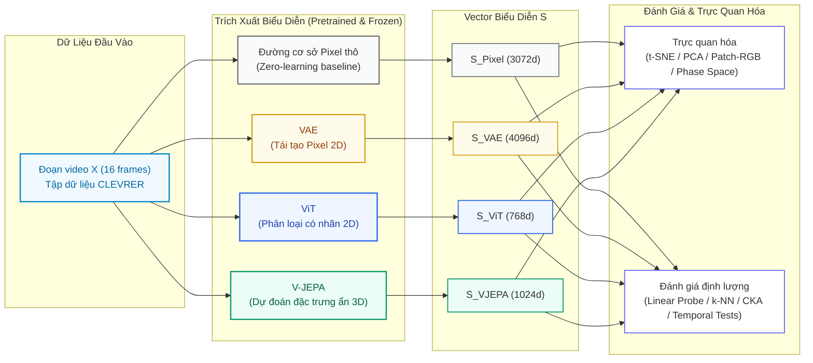

[🇬🇧 English Version](README.md) • [🇻🇳 Bản Tiếng Việt](README_VI.md)

# 🧠 VAE vs ViT vs V-JEPA: So sánh Performance thị giác của 3 mô hình

**So sánh không gian trạng thái của 3 mô hình đã được pretrained trên tập video CLEVRER**

*Project Nghiên cứu World Models · Louis Đăng Khoa 2510905*

---

### 📌 Tóm Tắt Nghiên Cứu

> **Mục tiêu huấn luyện cho thấy mô hình thể hiện những nội dung như sau:**
> - **VAE (Tái tạo pixel):** Nén pixel ở mức thấp; nhạy với vị trí và màu sàn, nhưng không hiểu về ngữ nghĩa cũng như môi trường.
> - **ViT (Phân loại có giám sát):** Nhận diện được thuộc tính như màu sắc, nhưng không hiểu về cấu trúc cảnh quan và những tương tác và động học theo thời gian do xử lý khung hình tĩnh.
> - **V-JEPA (Dự đoán đặc trưng bị che):** Nắm được cấu trúc cảnh 3D, số lượng thực thể và các tương tác vật lý.

---

### 📑 Mục Lục
0. [Đặt Vấn đề và Giả thuyết](#0)
1. [Sơ đồ Kiến trúc & Luồng Thực Thi (Pipeline)](#1)
2. [Tập Dữ Liệu: CLEVRER](#2)
3. [Ba Mô Hình So Sánh](#3)
4. [Trực Quan Hóa (Visualize)](#4)
5. [Phân Tích Định Lượng (Analyze)](#5)
6. [Thời Gian & Chuyển Động](#6)
7. [Tổng Kết & Thảo Luận](#7)
8. [Hạn Chế, Hướng Phát Triển & Tài Liệu Tham Khảo](#8)

---

## 0. Đặt Vấn đề và Giả thuyết

**Câu hỏi:** Khi áp dụng ba nguyên lý học biểu diễn (Tái tạo pixel, Phân loại có giám sát và Dự đoán đặc trưng ẩn trong video) lên cùng một chuỗi video, cho ra được biểu diễn $S$ sẽ phản ánh những khía cạnh nào: thông tin tĩnh hay tương tác?

| Ký hiệu | Mô hình | Mục tiêu tiền huấn luyện | Giả thuyết khoa học |
|:---:|:---|:---|:---|
| **H1** | **VAE** | Nén và tái tạo lại pixel | $S_{VAE}$ gom cụm theo màu sắc và bố cục; yếu về ngữ nghĩa, môi trường,.. |
| **H2** | **ViT** | Phân loại có giám sát | $S_{ViT}$ nhận ra vật thể, nhưng không thấy chuyển động vì chỉ nhìn từng frame |
| **H3** | **V-JEPA** | Dự đoán đặc trưng ngữ nghĩa của vùng tubelet bị che | $S_{VJEPA}$ mã hóa được không gian 3D, số lượng thực thể và các sự kiện va chạm hoặc tương tác. |

**Thiết kế:** Cả 3 mô hình đều được cố định trọng số (**Pretrained & Frozen**). Cùng một clip 16 frame đi qua cả 3 mạng. Bổ sung mốc **Pixel thô** (Zero-learning baseline) để nhận biết giá trị học được thực sự của các mô hình.

---

## 1. Sơ đồ Kiến trúc & Luồng Thực Thi (Pipeline)

### 🖼️ Sơ đồ Đồ họa Pipeline

### 🔄 Sơ đồ Luồng Tương Tác

---

## 2. Tập Dữ Liệu: CLEVRER

**CLEVRER** (*Collision Events for Video REpresentation and Reasoning* - MIT, ICLR 2020) là tập dữ liệu tổng hợp chuẩn mực mô phỏng tương tác vật lý 3D:
- Các vật thể hình học cơ bản (khối cầu, trụ, lập phương) trượt và va chạm đàn hồi trên mặt phẳng có ma sát.
- Mỗi video dài 5 giây (128 khung hình), đi kèm ground-truth metadata đầy đủ: màu sắc, hình dạng, chất liệu của từng vật, và thời điểm xảy ra va chạm.
- Dữ liệu cho phép bóc tách độc lập cả thông tin **tĩnh** ("vật thể là gì") lẫn **động** ("có va chạm không").

### 2.1 Tiền xử lý & Trích xuất 300 Video Clips
- **Phương pháp lấy mẫu:** Chọn ngẫu nhiên 300 video từ tập validation (5000 video). Lấy **16 khung hình phân bố đều** (khoảng 0.33s/khung hình) và chuẩn hóa kích thước về $256 \times 256$.
- **Cơ sở khoa học:** 16 khung hình là kích thước đầu vào chuẩn của V-JEPA, đồng thời bao quát trọn vẹn tiến trình trước, trong và sau va chạm của chuỗi tương tác vật lý.
- **Lưu trữ:** Lưu mảng NumPy `CLEVRER_videos.npy` kích thước `(300, 16, 256, 256, 3)`.

### 2.2 Trích Xuất Nhãn Thuộc Tính Từ Ground-Truth Metadata
- **Mục tiêu:** Xây dựng hệ thống nhãn mục tiêu phục vụ bài toán đánh giá năng lực biểu diễn.
- **Phân loại nhãn nghiên cứu:**
  1. **Nhãn tĩnh:** Sự hiện diện của màu sắc (8 màu cơ bản), khối lập phương (`has_cube`), và số lượng vật thể ($n_{objects} \in \{4, 5, 6\}$; gộp 2 mẫu cá biệt có 3 vật vào nhóm 4 vật).
  2. **Nhãn động:** Số lượng va chạm vật lý. Do 100% video đều có va chạm (`has_collision = 1.0`), nhãn này không có giá trị phân biệt. Định nghĩa biến phân loại nhị phân cân bằng: `many_coll3` (**từ 3 va chạm trở lên**, chiếm ~43% mẫu dương tính).
- **Nguyên tắc phương pháp luận:** Nhãn chỉ dùng ở tầng đánh giá độc lập; các mô hình backbone hoàn toàn không tiếp cận bất kỳ nhãn nào trong quá trình trích xuất đặc trưng.

---

## 3. Ba Mô Hình So Sánh

| Tiêu chí | 🟡 VAE (Stability AI) | 🔵 ViT (Google Research) | 🟢 V-JEPA 2.1 (Meta FAIR) |
|:---|:---|:---|:---|
| **Checkpoint** | `stabilityai/sd-vae-ft-mse` | `google/vit-base-patch16-224` | `vjepa2_1_vit_large_384` |
| **Hàm mục tiêu** | Nén và **tái tạo pixel** | **Phân loại có giám sát** (Cross-Entropy trên ImageNet) | **Dự đoán đặc trưng** bị che trong video ($\mathcal{L}_{L1}$) |
| **Đầu vào** | Từng khung hình 2D ($256 \times 256$) | Từng khung hình 2D ($224 \times 224$) | **Đồng thời chuỗi 16 khung hình** ($384 \times 384$) |
| **Biểu diễn theo thời gian** | Latent mean $4 \times 32 \times 32$ tại mỗi frame | Token `[CLS]` (768d) tại mỗi frame | Trung bình token của từng lát cắt 2 frame (8 lát) |
| **Vector clip $S$** | Trung bình 16 frames $\rightarrow$ **4096 chiều** | Trung bình 16 frames $\rightarrow$ **768 chiều** | Trung bình 8 lát cắt $\rightarrow$ **1024 chiều** |

### 🔬 Điểm khác biệt của các mô hình:
1. **VAE và ViT là mô hình ảnh 2D:** Khi áp dụng lên video sẽ xử lý từng khung hình độc lập. Phép lấy trung bình cộng theo thời gian **có tính giao hoán**, do đó triệt tiêu hoàn toàn thông tin về trật tự diễn tiến thời gian ($S(t_1, t_2) \equiv S(t_2, t_1)$).
2. **V-JEPA là mô hình Video 3D:** Cơ chế Self-Attention cho phép các token tại các thời điểm khác nhau tương tác trực tiếp với nhau, bảo toàn ngữ cảnh tương tác hoặc va chạm.

- **VAE: Tái tạo mức độ điểm ảnh:** Nén ảnh thành bản đồ đặc trưng tiềm ẩn $4 \times 32 \times 32$. Tối ưu hóa để giải mã ngược trở lại chính xác từng pixel $\rightarrow$ Giữ chặt thông tin cục bộ theo tọa độ không gian ("ở vị trí $(x, y)$ có pixel nào"). Trích xuất giá trị kỳ vọng (mean vector) để kết quả đạt tính tất định.
- **ViT: Học biểu diễn có giám sát:** Chia khung hình thành 196 patches $16 \times 16$, truyền qua Transformer Encoder. Token đặc biệt `[CLS]` gom cụm các thuộc tính đặc trưng của đối tượng chính (màu sắc, kết cấu bề mặt), nhưng bỏ qua hậu cảnh, không nhạy đối tượng phụ và không có nhận thức về trục thời gian.
- **V-JEPA 2.1: Nguyên lý JEPA (LeCun, 2022):** Không tái tạo pixel (tránh lãng phí tài nguyên), chỉ dự đoán **vector biểu diễn ngữ nghĩa** của các vùng video bị che khuất trong không gian tiềm ẩn:
  $$\mathcal{L}_{\text{V-JEPA}} = \left\| \text{Predictor}(S_{\text{context}}) - \text{TargetEncoder}(Y_{\text{masked}}) \right\|_1$$
  Video được chia thành các tubelets $2 \text{ frames} \times 16 \times 16 \text{ pixels}$. Muốn suy đoán được biểu diễn của vật thể ở các khung hình tương lai, mạng nơ-ron bắt buộc phải học được các tính chất vật lý: bảo toàn thực thể, hướng vận tốc, và tương tác va chạm.
- **Mốc Pixel Thô & Gom $S$:** Lấy trung bình cộng 16 frame theo thời gian, giảm tỷ lệ về $32 \times 32 \times 3$ và duỗi thẳng thành vector 3072 chiều. Đây là mốc đối chứng nhằm để nhận biết giá trị học được thực sự của các mô hình.

---

## 4. Trực Quan Hóa (Visualize)

Các vector trạng thái $S$ có từ $768$ đến $4096$ chiều. Dự kiến sẽ phải giảm chiều:
- **t-SNE (Phi tuyến):** Bảo toàn cấu trúc Local Neighborhoods. Lưu ý: Khoảng cách giữa các cụm và kích thước cụm **không mang ý nghĩa khoảng cách thực tế**.
- **PCA (Tuyến tính):** Các trục có Global Variance. Giữ nguyên tỷ lệ khoảng cách Euclid; phản ánh trung thực mức độ phân tán tuyến tính của dữ liệu.

> ⚠️ **Nguyên tắc phương pháp luận:** Mọi hình ảnh trực quan hóa 2D/3D chỉ để tham khảo. Kết luận bắt buộc phải dựa trên định lượng ở không gian gốc tại Mục 5, do giảm chiều luôn gây thất thoát thông tin.

### 4.1 Bản đồ t-SNE 2D: Cấu trúc phân bố vi mô
Chuẩn hóa Z-score, PCA 50 chiều tiền xử lý triệt tiêu nhiễu, sau đó chiếu t-SNE xuống 2 chiều phẳng (`outputs/figures/02_tsne.png`):

#### 🔍 Đọc Hiểu Biểu Đồ t-SNE 2D:
Dựa trên kết quả trực quan hóa t-SNE trên 300 video clips:
1. **Khả năng tự phân cụm số lượng vật thể (Cột giữa):**
   - **V-JEPA thể hiện sự phân tách rõ ràng:** Chuyển dải màu từ 4 vật thể (xanh lam), chuyển tiếp qua 5 vật thể (xám), đến 6 vật thể (đỏ cam). Nhấn mạnh rằng V-JEPA học hoàn toàn tự giám sát (không nhãn); điều này chứng minh *số lượng đối tượng độc lập là một trục phương sai tự nhiên được mô hình tự nhận biết* nhằm tối ưu hóa việc dự đoán các vùng bị che khuất.
   - **ViT hoàn toàn trộn lẫn:** Các điểm 4, 5, 6 vật thể đan xen ngẫu nhiên, token `[CLS]` sau khi trung bình hóa khung hình không giữ được thông tin đếm được tổng thể.
   - **VAE và Pixel thô xuất hiện sự phân tầng giả:** Các clip ít vật thể gom vào trung tâm do diện tích sàn xám lớn làm cho ma trận điểm ảnh tương đồng nhau, chứ không phản ánh khả năng biết được số lượng vật thể.
2. **Sự phân tán của nhãn màu và sự kiện va chạm (Cột trái & Cột phải):**
   - Cả 4 biểu diễn đều không tạo thành các cụm tách biệt rõ rệt trên 2D đối với nhãn có vật màu đỏ (`has_red`) và biến cố va chạm (`many_coll3`).
   - **Cơ sở lý luận:** Điều này **không đồng nghĩa** với việc biểu diễn thiếu thông tin. Phép chiếu t-SNE bị chi phối bởi các thành phần phương sai phân bố rộng. Các thuộc tính thứ cấp nằm trên các trục trực giao phụ sẽ bị làm phẳng trên 2D nên ta chưa thấy được, nhưng vẫn có thể thấy được ở Linear Probe ở Mục 5.

---

### 4.2 Phổ Phương Sai PCA & Số Chiều Nội Tại (Explained Variance Ratio)
Xác định số lượng thành phần cần thiết để bảo toàn 90% thông tin (`outputs/figures/03_pca_spectrum.png`):

#### 📊 Bảng định lượng phổ phương sai thực tế (`pca_spectrum.csv`):
- **Tỷ lệ giữ lại thông tin trên 2 thành phần chính đầu tiên (PC1 + PC2):**
  - **VAE:** Chỉ bảo toàn vỏn vẹn **4.8%** phương sai gốc.
  - **Pixel Thô:** Giữ **10.3%**.
  - **ViT:** Giữ **24.6%**.
  - **V-JEPA:** Giữ cao nhất với **35.6%** (và đạt **44.4%** trên 3 thành phần đầu).
- **Số lượng thành phần chính tối thiểu để bảo toàn 90% phương sai dữ liệu:**
  - **VAE:** Cần tới **202 components**.
  - **Pixel Thô:** Cần **120 components**.
  - **ViT:** Cần **59 components**.
  - **V-JEPA:** Chỉ cần **41 components**.

**Nhận định:**
1. Không gian biểu diễn của **VAE** có phương sai trải đều, thậm chí còn phân tán hơn cả Pixel thô. Điều này chứng minh VAE hoạt động như một bộ nén tín hiệu cục bộ, lưu giữ thông tin chi tiết dạng nhiễu hạt thay vì nhận biết thực sự về nó.
2. Ngược lại, **V-JEPA** các quy luật vật lý và cấu trúc cảnh được nén gọn vào một số ít trục phương sai nhất định, thể hiện vì sao hình chiếu PCA của V-JEPA luôn có cấu trúc rõ ràng nhất.

---

### 4.3 Trực Quan Hóa Không Gian 3D PCA
Mở rộng thêm trục phương sai thứ 3 để kiểm tra khả năng tách biệt của các thuộc tính (`outputs/figures/04_pca3d.png`):

#### 🔍 Nhận Xét Trên Không Gian 3D PCA:
1. **Trục PC3 giúp giải phóng thêm một bậc tự do:** Nâng tổng phương sai giải thích lên **44.4%** đối với V-JEPA và **32.5%** đối với ViT.
2. **Cấu trúc phân tầng số vật thể của V-JEPA:** Trong không gian 3 chiều, dải phân cách giữa nhóm 4, 5, và 6 vật thể của V-JEPA mở rộng thành các mặt cong tách biệt so với hình chiếu 2D, cho thấy thuộc tính số lượng thực thể tuyến tính mịn trong không gian $S_{VJEPA}$.
3. **Các sự kiện va chạm vẫn tiếp tục đan xen phức tạp:** trong không gian 3D, nhãn `many_coll3` của cả 3 mô hình vẫn chưa thể phân tách bằng một mặt phẳng. Điều này tái khẳng định rằng thông tin va chạm là một hàm phi tuyến phức tạp phân bố ở các chiều đặc trưng bậc cao, đòi hỏi kỹ thuật Linear Probing trên toàn bộ số chiều gốc để bóc tách.

---

### 4.4 Bản Đồ Nhiệt PCA-RGB theo Mảnh Ảnh: Mô Hình Phân Tách Cảnh Thế Nào?
Trích xuất toàn bộ các token không gian tại 4 mốc thời gian đặc trưng của clip có tương tác va chạm phức tạp nhất (`clip_6` và `clip_231`), áp dụng PCA chung để chiếu không gian đặc trưng xuống 3 chiều thành phần (kênh **Red - Green - Blue**). Các vùng không gian có cùng mã màu = các vector biểu diễn tương đồng nhau (`outputs/figures/05_patch_pca_rgb.png`):

#### 🔍 Nhận Xét Thực Nghiệm: Bản Đồ Nhiệt PCA-RGB Cấp Độ Mảnh Ảnh:
1. **Khả năng bóc tách thực thể (Object Disentanglement):**
   - **VAE:** Tạo ra một bản đồ màu phân tách, bị chi phối bởi cường độ ánh sáng, bóng đổ của các vật thể và các gợn của mặt sàn. VAE nhìn nhận thế giới dưới dạng các giá trị độ sáng pixel liên tục.
   - **ViT & V-JEPA:** Tách biệt hoàn toàn từng vật thể hình học khỏi mặt sàn. Mỗi vật thể được gán một khối màu đồng nhất, cơ chế Self-Attention đã nhóm các pixel lân cận thành các "khái niệm" tách biệt.
2. **Tính bảo toàn thực thể theo thời gian:**
   - Ở **V-JEPA**, khi các khối cầu và khối lập phương trượt và va chạm xuyên suốt 4 thời điểm ($t = 0, 6, 10, 14$), **mã màu RGB của từng vật thể được duy trì cực kỳ ổn định**.
   - Điều đó khẳng định: *Bộ mã hóa của V-JEPA theo dấu được thực thể xuyên suốt thời gian*.

---

## 5. Phân Tích Định Lượng (Analyze)

| Phương pháp | Câu hỏi kiểm chứng | Tiêu chuẩn |
|:---|:---|:---|
| **Linear Probing** (Logistic Regression) | Thông tin có tách được bằng một mặt phẳng trong S không? | Chuẩn đánh giá học tự giám sát (Alain & Bengio, 2016). |
| **k-NN Classifier** ($k=10$, Cosine metric) | Các clip gần nhau trong S có cùng nhãn không? | Đánh giá cấu trúc láng giềng tự nhiên, không cần tối ưu. |
| **Balanced Accuracy** | Khả năng phân loại tổng quát trên tập nhãn mất cân bằng. | Điểm chuẩn ngẫu nhiên: **0.50** (nhị phân), **0.33** (3 lớp). |

### 5.1 Kết Quả Linear Probing & k-NN
Bảng số liệu tổng hợp định lượng trên toàn bộ không gian gốc (`probe_summary.csv` & `probe_full.csv`):

| Nhiệm vụ đánh giá (Balanced Accuracy) | Pixel Thô (Baseline) | VAE (4096d) | ViT (768d) | V-JEPA (1024d) |
|---|:---:|:---:|:---:|:---:|
| **Nhận diện màu sắc (Trung bình 8 màu)** | $0.577 \pm 0.017$ | $0.635 \pm 0.016$ | $\mathbf{0.939 \pm 0.006}$ | $0.872 \pm 0.010$ |
| **Phát hiện khối lập phương (`has_cube`)** | $0.520 \pm 0.020$ | $0.513 \pm 0.006$ | $0.782 \pm 0.014$ | $\mathbf{0.982 \pm 0.004}$ |
| **Phân loại số lượng vật thể (`n_obj`)** | $0.549 \pm 0.029$ | $0.628 \pm 0.013$ | $0.669 \pm 0.007$ | $\mathbf{0.929 \pm 0.004}$ |
| **Phát hiện $\ge 3$ va chạm (`many_coll3`)** | $0.514 \pm 0.015$ | $0.554 \pm 0.030$ | $0.527 \pm 0.015$ | $\mathbf{0.752 \pm 0.012}$ |
| **k-NN ($k=10$): Phân loại số lượng vật** | $0.333$ | $0.333$ | $0.540$ | $\mathbf{0.778}$ |
| **k-NN ($k=10$): Phát hiện va chạm** | $0.488$ | $0.464$ | $0.531$ | $\mathbf{0.539}$ |

#### 🔬 Ba Kết Luận Bản Chất Từ Số Liệu:
1. **VAE thất bại về nhận thức không gian:** Độ chính xác nhận diện màu sắc của VAE chỉ đạt **0.635** (kém xa ViT 0.939 và V-JEPA 0.872), trong khi phát hiện khối lập phương rơi về mức ngẫu nhiên (**0.513**). Bản đồ $4 \times 32 \times 32$ bị gắn chặt với vị trí pixel; khi duỗi thẳng, không thể học được khái quát khi vật thể xuất hiện ở các vị trí ngẫu nhiên trên màn hình.
2. **ViT thiên vị đặc trưng bề mặt, đoán mò cấu trúc và thời gian:** ViT dẫn đầu ở bài toán màu sắc (**0.939**), thể hiện năng lực trích xuất thuộc tính thị giác tĩnh từ pretraining ImageNet. Ở bài toán va chạm, ViT rơi về mức đoán mò (**0.527** so với baseline ngẫu nhiên 0.50), việc lấy trung bình cộng khung hình đã triệt tiêu thứ tự thời gian.
3. **V-JEPA nắm bắt cảnh 3D và vật lý:** V-JEPA đạt điểm cao nhất ở hình học 3D (**0.982** cho khối lập phương) và đếm số lượng vật thể (**0.929**; k-NN đạt **0.778**). Đặc biệt, V-JEPA là mô hình duy nhất giải mã được va chạm (**0.752**).
4. **Độ ổn định thống kê:** Độ lệch chuẩn qua 5 seeds lặp lại đều cực nhỏ ($\sigma < 0.015$), có khoảng cách lớn là bản chất thực sự của không gian biểu diễn, hoàn toàn không phải do yếu tố may rủi khi chia dữ liệu.

---

### 5.2 Kiểm Soát Biến Nhiễu: V-JEPA Có Dùng "Đường Tắt" Để Đoán Va Chạm?
- **Giả thuyết:** V-JEPA đếm vật thể rất chính xác ($\approx 0.93$). Nếu trong tập dữ liệu, các cảnh có nhiều vật thể ngẫu nhiên xuất hiện nhiều va chạm hơn, liệu V-JEPA có đang "ăn gian" bằng cách dựa vào số lượng vật thể để suy diễn va chạm thay vì thực sự nhận thức được chuyển động?
- **Quy trình nghiệm chứng:** Đánh giá tương quan giữa số vật thể và tỷ lệ va chạm trong tập dữ liệu; thực hiện Linear Probe phân loại va chạm **riêng biệt bên trong từng nhóm cố định số vật thể** ($n=4, 5, 6$). Khi số vật thể là một hằng số, đường tắt sẽ bị vô hiệu hóa (`probe_controlled.csv`):

| Nhóm điều kiện thực nghiệm | VAE | ViT | V-JEPA | Baseline Ngẫu Nhiên |
|---|:---:|:---:|:---:|:---:|
| **Nhóm cố định $n_{objects} = 4$** | $0.525$ | $0.595$ | $\mathbf{0.687}$ | $0.500$ |
| **Nhóm cố định $n_{objects} = 5$** | $0.509$ | $0.472$ | $\mathbf{0.676}$ | $0.500$ |
| **Nhóm cố định $n_{objects} = 6$** | $0.535$ | $0.526$ | $\mathbf{0.631}$ | $0.500$ |
| **Trung bình cố định số vật** | **0.523** | **0.531** | **0.665** | **0.500** |

#### 🔍 Phân tích và kết luận đanh thép:
1. Khi kiểm tra tương quan trong tập dữ liệu, tỷ lệ va chạm nhiều (`many_coll3`) phân bố đều giữa 3 nhóm (41% ở nhóm 4 vật, 44% ở nhóm 5 vật, và 43% ở nhóm 6 vật). Nếu một mô hình chỉ dùng số lượng vật thể để suy đoán va chạm, độ chính xác chỉ đạt đúng **0.500**.
2. Khi cô lập yếu tố số lượng vật thể (huấn luyện và kiểm tra Probe độc lập bên trong từng nhóm 4, 5, 6 vật), **V-JEPA vẫn duy trì hiệu năng phân loại va chạm ở mức trung bình 0.665**.
3. Sự sụt giảm nhẹ từ 0.752 xuống 0.665 dễ hiểu về mặt thống kê: kích thước mẫu huấn luyện ở mỗi nhóm bị chia nhỏ xuống chỉ còn ~100 clips.
4. **Kết luận:** *Khẳng định V-JEPA thực sự mã hóa thông tin va chạm trong không gian.*

---

### 5.3 Mức Độ Tương Đồng Cấu Trúc Biểu Diễn Giữa Các Mô Hình (Linear CKA)
Sử dụng công cụ Centered Kernel Alignment (CKA - Kornblith et al., ICML 2019) để đo lường mức độ tương đồng giữa các không gian biểu diễn (`outputs/figures/07_cka.png`):

#### Bảng ma trận CKA thực tế (`cka.csv`):
| Mô hình | Pixel Thô | VAE | ViT | V-JEPA |
|---|:---:|:---:|:---:|:---:|
| **Pixel Thô** | $1.000$ | **0.711** | $0.204$ | $0.353$ |
| **VAE** | **0.711** | $1.000$ | $0.335$ | $0.441$ |
| **ViT** | $0.204$ | $0.335$ | $1.000$ | **0.502** |
| **V-JEPA** | $0.353$ | $0.441$ | **0.502** | $1.000$ |

#### 🔍 Nhận xét 2 quy luật biểu diễn:
1. **VAE bảo toàn cấu trúc hình học của không gian điểm ảnh:** Hệ số tương đồng giữa VAE và Pixel thô đạt mức rất cao (**0.711**). Điều này khẳng định không gian latent của VAE chủ yếu là phân bố thống kê của pixel cấp thấp.
2. **Sự hội tụ ngữ nghĩa giữa hai kiến trúc Transformer:** Cặp **ViT – V-JEPA** đạt độ tương đồng cao nhất giữa các mô hình học sâu (**0.502**), cao hơn đáng kể so với tương quan của chúng với VAE ($0.335$ và $0.441$). Việc cùng sử dụng cơ chế Self-Attention đã làm hai mô hình cùng hội tụ về việc nắm bắt cấu trúc thực thể.

---

### 5.4 Truy Vấn Video Tương Đồng Nhất
Đối với mỗi mô hình, khái niệm "hai video tương đồng nhau" được định nghĩa dựa trên những đặc trưng gì? Sử dụng khoảng cách Cosine trên từng không gian biểu diễn $S$ để trích xuất 5 video láng giềng gần nhất (`outputs/figures/08_retrieval.png`):

#### 🔍 Nhận Xét: Tiêu Chuẩn "Tương Đồng" Trong Nhận Thức Của Từng Mô Hình:
- **Pixel Thô & VAE:** Trả về các video có **bố cục hình học sàn nền và vị trí bóng đổ gần như trùng khít**. Khi sàn trống chiếm phần lớn diện tích, hai mô hình này coi các video có cùng diện tích sàn trống là "giống nhau".
- **ViT:** Bị chi phối bởi màu sắc bề mặt. Các clip được truy vấn luôn chứa các vật thể mang **gam màu chủ đạo trùng khớp với clip gốc** (ví dụ: clip gốc có khối cầu đỏ và trụ xanh thì các kết quả trả về đều chứa hai màu này).
- **V-JEPA:** Có tỷ lệ viền xanh lá. Các video láng giềng được trả về luôn có **cùng số lượng thực thể chính xác và cùng mật độ tương tác va chạm**, cho thấy độ tương đồng Cosine trong không gian $S_{VJEPA}$ đại diện cho sự tương đồng về cấu trúc vật lý của thế giới.

---

## 6. Thời Gian và Chuyển Động

**Câu hỏi:** Mô hình có thực sự hiểu được thứ tự thời gian và chuyển động, hay chỉ ghi nhận sự xuất hiện của các dấu hiệu tĩnh? Thiết kế hệ thống thực nghiệm đa tầng bậc gồm 3 mức:

### 6.1 Mức Độ 1: Biểu Diễn Có Biến Đổi Trước Các Tác Vụ Can Thiệp Thời Gian?
Đo chỉ số chuẩn hóa độ tương đồng Cosine:
$$\text{Sim}_{\text{norm}} = \frac{\cos(S_{\text{gốc}}, S_{\text{biến đổi}}) - \overline{\cos}_{\text{ngẫu nhiên}}}{1 - \overline{\cos}_{\text{ngẫu nhiên}}}$$
Giá trị **1.0** thể hiện biểu diễn hoàn toàn bất biến (không phân biệt được sự can thiệp); giá trị tiến dần về **0.0** (hoặc âm) thể hiện vector biến đổi sâu sắc (`outputs/figures/09_temporal_similarity.png`):

#### Bảng độ tương đồng Cosine chuẩn hóa thực tế (`temporal_similarity.csv`):
| Biến đổi can thiệp thời gian | VAE | ViT | V-JEPA |
|---|:---:|:---:|:---:|
| **Phát ngược video (Reverse)** | **1.000** | **1.000** | **0.788** |
| **Xáo trộn khung hình ngẫu nhiên (Shuffle)** | **1.000** | **1.000** | **-0.061** |
| **Đóng băng khung hình giữa (Freeze)** | $0.333$ | $0.624$ | **-0.948** |

**Diễn giải:** VAE và ViT bằng **1.00** với phát ngược và xáo trộn là **đương nhiên** (trung bình không quan tâm thứ tự). Phát hiện nằm ở cột V-JEPA: nếu thấp hơn 1 thì V-JEPA **nhạy** với thứ tự frame. **Nhưng nhạy chưa phải là hiểu**: mô hình nào có mã hóa vị trí thời gian cũng sẽ đổi. Vì vậy cần mức 2 và 3.

---

### 6.2 Mức Độ 2: Phân Định Chiều Thời Gian (Xuôi vs Ngược)
Tập dữ liệu gồm 100 video gốc (nhãn 0: chiều thời gian thực) và 100 video phát ngược tương ứng (nhãn 1: đảo ngược thời gian). Phân chia dữ liệu theo nhóm (`GroupKFold` theo Video ID) để ngăn chặn rò rỉ dữ liệu (`outputs/direction_probe.csv`):

| Mô hình | Xuôi / Ngược |
|:---|:---:|
| **VAE** | 0.500 |
| **ViT** | 0.500 |
| **V-JEPA** | **0.975** |

#### 🔍 Nhận Xét Thực Nghiệm: Mức Độ 2 - Nhận Thức Về Thứ Tự Thời Gian:
- **VAE và ViT đạt chính xác 0.500 (đoán ngẫu nhiên):** Phép trung bình cộng theo thời gian có tính giao hoán: $S(X_{\text{xuôi}}) \equiv S(X_{\text{ngược}})$. Hai vector giống hệt nhau về mặt toán học, bất kỳ bộ phân loại nào cũng không thể phân biệt được.
- **V-JEPA đạt 0.975 (gần như hoàn hảo):** Cơ chế dự đoán đặc trưng tubelet bắt buộc mô hình phải học các quy luật chuyển động (vận tốc, gia tốc, sự biến đổi sau va chạm). Khi đảo ngược thời gian, các quy luật vật lý bị vi phạm (ví dụ: hai vật tự nhiên hút nhau hoặc tăng tốc không có lực tác động), V-JEPA nhận ra ngay sự bất thường này trong không gian biểu diễn.

---

### 6.3 Mức Độ 3: Kiểm Định Tính Nhân Quả (Causal Verification)
Khi cố tình triệt tiêu hoàn toàn chuyển động (đóng băng video thành ảnh tĩnh lặp lại), thông tin về sự kiện va chạm có biến mất hay không? Huấn luyện Probe trên video đóng băng (`outputs/figures/10_freeze_probe.png` và `outputs/freeze_collision_probe.csv`):

#### 🔍 Nhận Xét: Mức Độ 3 - Kiểm Định Tính Nhân Quả:
- Khi đóng băng video, độ chính xác phát hiện va chạm của ViT rơi thẳng về mức đoán mò.
- V-JEPA khẳng định thông tin va chạm phụ thuộc nhân quả vào sự biến thiên theo thời gian thực sự, không dựa vào dấu hiệu tĩnh của từng khung hình riêng lẻ.

---

### 6.4 Biến Thiên Trạng Thái Tiềm Ẩn & Tương Quan Va Chạm (AUC)
Phân tích độ lớn biến thiên vector trạng thái theo từng bước thời gian so với mốc va chạm thực tế (`outputs/figures/11_change_clip231.png` và `11_change_clip6.png`):

| Clip 231 (Tương Tác Va Chạm) | Clip 6 (Chuyển Động Trôi Tự Do) |
|:---:|:---:|
|  |  |

---

### 6.5 Quỹ Đạo Động Lực Học Trên Mặt Phẳng Pha PCA 2D (Ảnh Động GIF)
Quan sát quỹ đạo tiến hóa của vector trạng thái đồng bộ với diễn biến video thực tế:

| Clip 231 (Tương Tác Va Chạm Đa Vật Thể) | Clip 6 (Chuyển Động Quán Tính) |
|:---:|:---:|
|  |  |

#### 🔍 Nhận Xét: Quỹ Đạo Động Lực Học Trên Mặt Phẳng Pha PCA 2D:
1. **Quỹ đạo của V-JEPA:** Thể hiện tính định hướng không gian mượt mà, uốn lượn có hướng rõ rệt và xuất hiện các bước ngoặt đổi hướng trạng thái ngay tại thời điểm xảy ra va chạm chính. Do không gian PCA 2D được fit trên toàn bộ tập hợp các mốc thời gian của 300 video, sự dịch chuyển này phản ánh trung thực tiến trình tiến hóa trạng thái trong không gian thế giới quan của mô hình.
2. **Quỹ đạo của VAE và ViT:** Có xu hướng co cụm hoặc dao động giật cục xung quanh vùng trung tâm, phản ánh sự biến thiên mạnh về mặt quang học nhưng thiếu tính liên tục về mặt ngữ nghĩa và vật lý.

> ⚠️ **Note:** Animation chỉ đóng vai trò hỗ trợ ta quan sát hình học về sự dịch chuyển trạng thái. Toàn bộ các kết luận về tính chất thời gian dựa trên các kiểm định định lượng ở không gian đầy đủ tại các Mục 5.2, 6.2, 6.3 và 6.4.

---

## 7. Tổng Kết & Thảo Luận

### 7.1 Bảng Tổng Kết Định Lượng Toàn Diện (`outputs/summary.csv`)
| Tiêu chí | Raw Pixel | VAE | ViT | V-JEPA |
|---|:---:|:---:|:---:|:---:|
| **Số chiều S** | 3072 | 4096 | 768 | 1024 |
| **Probe: màu (TB 8)** | 0.577 | 0.635 | **0.939** | 0.872 |
| **Probe: khối lập phương** | 0.520 | 0.513 | 0.782 | **0.982** |
| **Probe: số vật** | 0.549 | 0.628 | 0.669 | **0.929** |
| **Probe: $\ge 3$ va chạm** | 0.514 | 0.554 | 0.527 | **0.752** |
| **Va chạm, cố định số vật** | 0.488 | 0.523 | 0.531 | **0.665** |
| **2 PC giữ (%)** | 10.3% | 4.8% | 24.6% | **35.6%** |
| **CKA với Pixel** | 1.000 | **0.711** | 0.204 | 0.353 |
| **Xuôi/ngược (probe)** | — | 0.500 | 0.500 | **0.975** |
| **Va chạm khi đóng băng** | — | 0.527 | 0.685 | 0.648 |
| **AUC thay đổi $\leftrightarrow$ va chạm** | — | 0.629 | 0.637 | 0.524 |
| **Tham số (triệu)** | 0 | 83.7M | 85.8M | 304.7M |
| **Giây/clip** | — | 2.51s | **0.73s** | 5.46s |
| **VRAM đỉnh (GB)** | — | 1.02 GB | **0.50 GB** | 1.54 GB |

---

### 7.2 Đối Chiếu Giả Thuyết Ban Đầu

| Giả thuyết khoa học | Đánh giá thực nghiệm | Bằng chứng định lượng xác thực |
|:---|:---:|:---|
| **H1 (VAE):** Biểu diễn gom cụm theo màu sắc và bố cục, yếu về ngữ nghĩa toàn cục. | ❌ **Bác bỏ một phần** (Về thuộc tính màu sắc) | Độ chính xác nhận diện màu sắc của VAE chỉ đạt **0.635** (gần sát mức Baseline Pixel thô 0.577). Không gian latent phụ thuộc chặt vào tọa độ không gian nên không thể tổng hợp thông tin màu sắc trừu tượng toàn cục. CKA với Pixel thô lên tới **0.711**. |
| **H2 (ViT):** Nhận diện tốt thuộc tính vật thể, hoàn toàn "mù" chuyển động thời gian. | ✅ **Được ủng hộ** | Độ chính xác nhận diện màu sắc đạt đỉnh (**0.939**), nhưng nhận diện va chạm rơi hoàn toàn về mức đoán mò (**0.527** so với baseline 0.500); phân định chiều thời gian đạt đúng **0.500** do phép trung bình cộng có tính giao hoán. |
| **H3 (V-JEPA):** Nắm bắt vượt trội cấu trúc cảnh 3D và động lực học va chạm. | ✅ **Được ủng hộ** | Dẫn đầu ở bài toán nhận diện khối lập phương (**0.982**), đếm số lượng vật thể (**0.929**), và là mô hình duy nhất dự đoán thành công sự kiện va chạm (**0.752**; duy trì **0.665** khi cố định số vật). Phân định chiều thời gian đạt mức ấn tượng **0.975**. |

---

### 7.3 Kết Luận

1. **Mục tiêu train quyết định biểu diễn chứa gì.** Dựng lại pixel $\rightarrow$ chi tiết theo vị trí. Phân loại ảnh $\rightarrow$ đặc điểm nhận diện. Đoán đặc trưng bị che trong video $\rightarrow$ vật thể, cấu trúc cảnh và một phần động lực học.
2. **Không cần nhãn vẫn đạt ngữ nghĩa, với điều kiện dự đoán trong không gian ẩn chứ không phải pixel.** V-JEPA (không nhãn) ngang hoặc hơn ViT (có nhãn) ở cấu trúc cảnh, trong khi VAE thua. Đây là luận điểm của kiến trúc JEPA (LeCun, 2022).
3. **Với world model**, thứ cần là một trạng thái để dự đoán tương lai. Trong ba mô hình, V-JEPA là nền tảng phù hợp nhất. VAE phù hợp khi cần **sinh lại ảnh**, ViT khi cần **nhận diện vật**.
4. **Hình 2D dễ đánh lừa.** t-SNE không thấy va chạm nhưng probe thấy; quỹ đạo PCA 2D trông như "V-JEPA đổi đúng lúc va chạm" nhưng đo trong không gian đầy đủ thì không xác nhận. Kết luận phải dựa trên số đo.

---

## 8. Hạn Chế, Hướng Phát Triển & Tài Liệu Tham Khảo

### Hạn chế
- **Không cùng điều kiện:** ba mô hình khác kích thước (ViT 86M, V-JEPA khoảng 305M tham số), khác dữ liệu train (ảnh tĩnh và video), khác độ phân giải (256, 224, 384). Kết luận là về **nguyên lý học**, không phải xếp hạng tuyệt đối.
- **Giao thức bất lợi cho mô hình ảnh:** trung bình 16 frame xóa thứ tự thời gian của VAE và ViT. Kết quả va chạm và xuôi/ngược của hai mô hình này một phần do cách dùng.
- **Probe tuyến tính** chỉ đo thông tin *dễ lấy*. VAE có 4096 chiều với 300 mẫu; probe phi tuyến có thể cho VAE điểm cao hơn.
- **Dữ liệu:** 300 clip, cảnh render tổng hợp, chưa phải video thật. Nhãn va chạm là số lần, chưa xét thời điểm hay vật nào va vật nào.
- **Phần 6.2 và 6.3** chỉ có 100 clip (sai số khoảng $\pm 0.05$). t-SNE chạy một seed; hình PCA-RGB và animation chỉ minh họa trên 1 đến 2 clip.

### Hướng mở rộng
- Kiểm tra trên video thật (UCF101-subset, Kinetics-mini) với cùng pipeline.
- Probe phi tuyến (MLP nhỏ) để xem VAE có thông tin "ẩn" không.
- Dùng predictor của V-JEPA để **dự đoán frame tương lai** trong không gian ẩn, tức kiểm tra trực tiếp vai trò world model.

---

### 📚 Tài Liệu Tham Khảo Chọn Lọc (References)
1. **Kingma, D. P., & Welling, M. (2014).** *Auto-Encoding Variational Bayes*. International Conference on Learning Representations (ICLR).
2. **Rombach, R., Blattmann, A., Lorenz, D., Esser, P., & Ommer, B. (2022).** *High-Resolution Image Synthesis with Latent Diffusion Models* (Stable Diffusion VAE). IEEE/CVF CVPR.
3. **Dosovitskiy, A., et al. (2021).** *An Image is Worth 16x16 Words: Transformers for Image Recognition at Scale* (ViT). ICLR.
4. **Bardes, A., Ponce, J., & LeCun, Y. (2024).** *Revisiting Feature Prediction for Learning Visual Representations from Video* (V-JEPA). arXiv:2404.08471.
5. **Assran, M., et al. (2025).** *V-JEPA 2: Self-Supervised Video Models Enable Understanding, Prediction and Planning*. arXiv:2506.09985.
6. **Yi, K., Gan, C., Li, Y., Kohli, P., Wu, J., Torralba, A., & Tenenbaum, J. B. (2020).** *CLEVRER: CoLlision Events for Video REpresentation and Reasoning*. ICLR.
7. **Kornblith, S., Norouzi, M., Lee, H., & Hinton, G. (2019).** *Similarity of Neural Network Representations Revisited* (CKA). International Conference on Machine Learning (ICML).
8. **Alain, G., & Bengio, Y. (2016).** *Understanding intermediate layers using linear classifier probes*. arXiv:1602.04428.
9. **LeCun, Y. (2022).** *A Path Towards Autonomous Machine Intelligence*. OpenReview Position Paper.

---

## 📄 Bản Quyền (License)

Dự án được phân phối dưới giấy phép mã nguồn mở **MIT License**. Chi tiết xem tại [LICENSE](LICENSE).
