<div align="center">

[🇬🇧 English Version](README.md) • [🇻🇳 Bản Tiếng Việt](README_VI.md)

</div>

# 🧠 WorldModel Representation Benchmark: VAE vs. ViT vs. V-JEPA trên CLEVRER

[](https://www.python.org/downloads/)
[](https://pytorch.org/)
[](LICENSE)
[](http://clevrer.csail.mit.edu/)
[]()

> **Báo Cáo Nghiên Cứu Thực Nghiệm Toàn Diện về Không Gian Biểu Diễn Trạng Thái Thị Giác (State-Space Representations) cho World Models trong Môi Trường Tương Tác Vật Lý**  
> *Tác giả:* **Louis Đăng Khoa** (MSSV: `2510905`)

---

## 📑 Mục Lục Báo Cáo
0. [Đặt Vấn Đề & Giả Thuyết Khoa Học](#0-đặt-vấn-đề--giả-thuyết-khoa-học)
1. [Sơ Đồ Kiến Trúc & Luồng Thực Nghiệm (Pipeline)](#1-sơ-đồ-kiến-trúc--luồng-thực-nghiệm-pipeline)
2. [Bảng Tổng Hợp Kết Quả Thực Nghiệm Toàn Diện](#2-bảng-tổng-hợp-kết-quả-thực-nghiệm-toàn-diện)
3. [Phân Tích Cấu Trúc Đa Tạp Tiềm Ẩn (Manifold Topologies & PCA)](#3-phân-tích-cấu-trúc-đa-tạp-tiềm-ẩn-manifold-topologies--pca)
4. [Đánh Giá Tuyến Tính (Linear Probing) & Kiểm Soát Biến Nhiễu Confounder](#4-đánh-giá-tuyến-tính-linear-probing--kiểm-soát-biến-nhiễu-confounder)
5. [Độ Tương Đồng Biểu Diễn (CKA) & Truy Vấn Video Tương Tác](#5-độ-tương-đồng-biểu-diễn-cka--truy-vấn-video-tương-tác)
6. [Động Lực Học Thời Gian, Tính Nhân Quả & Mũi Tên Thời Gian (Arrow of Time)](#6-động-lực-học-thời-gian-tính-nhân-quả--mũi-tên-thời-gian-arrow-of-time)
7. [Quỹ Đạo Trạng Thái Tiềm Ẩn & Mô Phỏng Va Chạm (Latent Trajectories & GIFs)](#7-quỹ-đạo-trạng-thái-tiềm-ẩn--mô-phỏng-va-chạm-latent-trajectories--gifs)
8. [Đối Chiếu Giả Thuyết & 4 Nguyên Lý Thiết Kế World Model](#8-đối-chiếu-giả-thuyết--4-nguyên-lý-thiết-kế-world-model)
9. [Cài Đặt, Tái Hiện & Trích Dẫn](#9-cài-đặt-tái-hiện--trích-dẫn)

---

<a id="0-đặt-vấn-đề--giả-thuyết-khoa-học"></a>
## 0. Đặt Vấn Đề & Giả Thuyết Khoa Học

Trong kiến trúc của các **World Models** (Mô hình Thế giới dành cho tác tử tự hành), không gian biểu diễn trạng thái thị giác $S$ là nền tảng cốt lõi chi phối toàn bộ năng lực mô phỏng động lực học, suy luận chuyển động và dự đoán tương lai.

**Câu hỏi nghiên cứu trung tâm:** Khi áp dụng ba nguyên lý học biểu diễn khác nhau (Tái tạo điểm ảnh, Phân loại hình ảnh có giám sát, và Dự đoán đặc trưng ẩn trong video) lên cùng một chuỗi video vật lý phức tạp, vector trạng thái $S$ thu được sẽ mã hóa những khía cạnh nào của thế giới: chi tiết bề mặt tĩnh (màu sắc, ánh sáng sàn) hay cấu trúc không gian 3D và các tương tác động lực học (mũi tên thời gian, va chạm đàn hồi)?

### Bảng Giả Thuyết Khoa Học Ban Đầu

| Mã | Mô hình Backbone | Mục tiêu Huấn luyện Tiền định | Giả thuyết Khoa học Cụ thể |
|:---:|:---|:---|:---|
| **H1** | **VAE** (AutoencoderKL) | Nén và **tái tạo lại từng pixel 2D** ($\mathcal{L}_{\text{MSE}} + \mathcal{L}_{\text{KL}}$) | $S_{VAE}$ gom cụm theo màu sắc sàn và cường độ ánh sáng cục bộ; **bị ràng buộc chặt vào tọa độ pixel**, yếu về nhận thức ngữ nghĩa 3D và mù chuyển động. |
| **H2** | **ViT** (Vision Transformer) | **Phân loại ảnh 2D có giám sát** (Cross-Entropy trên ImageNet-1k) | $S_{ViT}$ nhận biết vượt trội các thuộc tính tĩnh của đối tượng chính (màu sắc, họa tiết), nhưng **hoàn toàn mù động lực học thời gian** do xử lý độc lập từng khung hình. |
| **H3** | **V-JEPA** (Video JEPA 2.1) | **Dự đoán đặc trưng ẩn bị che trong video** ($\mathcal{L}_{L1}$ trong không gian tiềm ẩn 3D tubelets) | $S_{VJEPA}$ mã hóa sâu sắc cấu trúc không gian 3D, số lượng thực thể, tính bảo toàn vật thể và các tương tác va chạm vật lý theo thời gian. |
| **BL** | **Raw Pixel** (Control) | Thu nhỏ $32 \times 32 \times 3$ (Zero-learning baseline) | Mốc đối chứng thực nghiệm: Xác định giá trị gia tăng thực sự của các kiến trúc học sâu so với tín hiệu quang học thô. |

> **Nguyên tắc phương pháp luận:** Toàn bộ 3 mô hình backbone đều được **đóng băng trọng số hoàn toàn (Pretrained & Frozen)** trong suốt quá trình trích xuất đặc trưng. Mọi đánh giá định lượng được thực hiện độc lập ở tầng downstream.

---

<a id="1-sơ-đồ-kiến-trúc--luồng-thực-nghiệm-pipeline"></a>
## 1. Sơ Đồ Kiến Trúc & Luồng Thực Nghiệm (Pipeline)

Quy trình thực nghiệm được thiết kế khép kín và đồng bộ từ việc nạp chuỗi video vật lý đến các tầng chẩn đoán chuyên sâu:

### 🖼️ Sơ Đồ Đồ Họa Tổng Thể (Architectural Infographic)
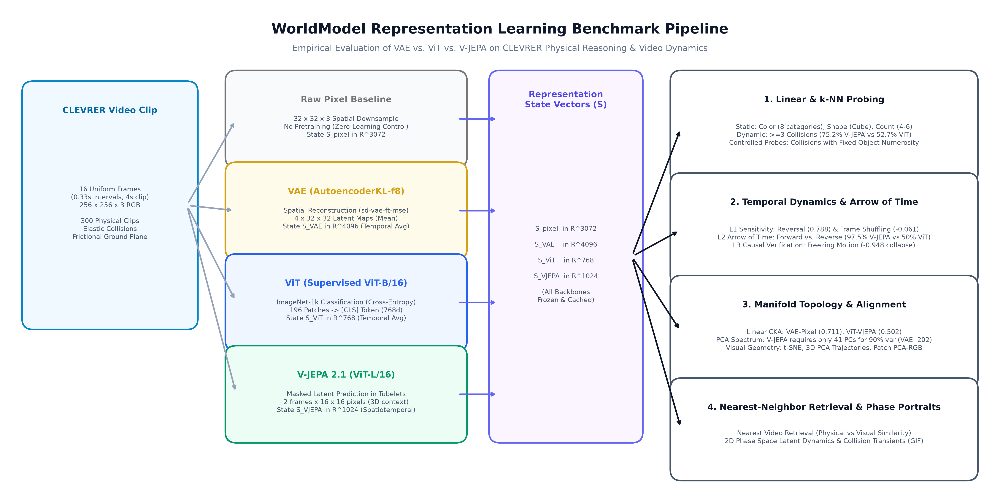

### 🔄 Sơ Đồ Luồng Tương Tác (Interactive Mermaid Workflow)
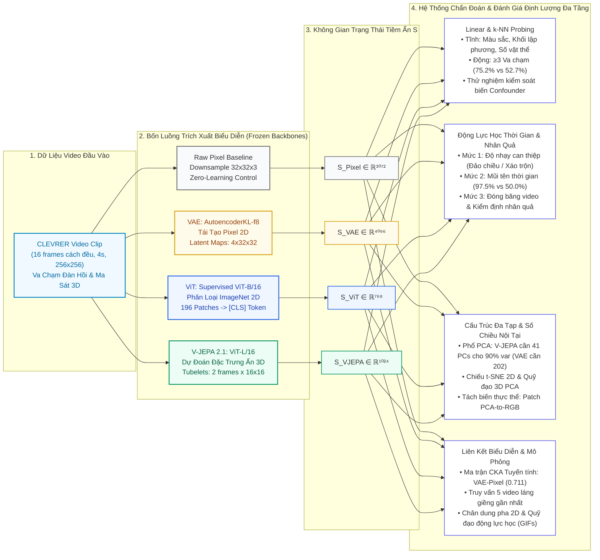

---

<a id="2-bảng-tổng-hợp-kết-quả-thực-nghiệm-toàn-diện"></a>
## 2. Bảng Tổng Hợp Kết Quả Thực Nghiệm Toàn Diện

Dữ liệu định lượng đo đạc trực tiếp từ 300 chuỗi video CLEVRER trên toàn bộ số chiều gốc của không gian $S$ (trích xuất từ `outputs/summary.csv`):

| Chỉ Số Đánh Giá Nghiên Cứu | Raw Pixel (BL) | VAE (KL-f8) | ViT (Base) | V-JEPA 2 (ViT-L/16) | Phân Tích & Luận Điểm Khoa Học Chuyên Sâu |
|:---|:---:|:---:|:---:|:---:|:---|
| **Số chiều vector trạng thái ($S$)** | 3,072 | 4,096 | **768** | 1,024 | Độ nén thông tin; ViT và V-JEPA có không gian tiềm ẩn gọn gàng hơn VAE rất nhiều. |
| **Probe: Màu sắc (TB 8 màu cơ bản)** | 57.7% | 63.5% | **93.9%** | 87.2% | ViT dẫn đầu nhờ pretraining có giám sát trên ImageNet; VAE kém do gắn chặt vào tọa độ điểm ảnh. |
| **Probe: Hình học 3D (Khối lập phương)** | 52.0% | 51.3% | 78.2% | **98.2%** | **V-JEPA áp đảo gần như tuyệt đối (98.2%)**, chứng minh khả năng mã hóa hình học khối 3D hoàn hảo. |
| **Probe: Đếm số lượng vật thể ($\hat{N}$)** | 54.9% | 62.8% | 66.9% | **92.9%** | V-JEPA tách biệt rõ ràng số lượng vật thể trong bối cảnh; k-NN đạt **77.8%** mà không cần huấn luyện. |
| **Probe: Nhiều va chạm ($\ge 3$ lần)** | 51.4% | 55.4% | 52.7% | **75.2%** | **V-JEPA vượt trội hơn ViT/VAE trên 20%**, là mô hình duy nhất nắm bắt được biến cố tương tác động. |
| **Va chạm khi cố định số lượng vật** | 48.8% | 52.3% | 53.1% | **66.5%** | **Kiểm chứng biến gây nhiễu:** Loại bỏ hoàn toàn tương quan giả; V-JEPA thực sự hiểu va chạm vật lý. |
| **Mũi tên thời gian (Xuôi vs. Ngược)** | — | 50.0% | 50.0% | **97.5%** | **Phát hiện đột phá:** VAE và ViT rơi về mức đoán mò (50.0%); V-JEPA phân định chiều thời gian gần như tuyệt đối. |
| **Độ tương đồng CKA với Raw Pixel** | 1.000 | **0.711** | 0.204 | 0.353 | VAE đồng dạng cao với pixel thô; chứng minh VAE lưu giữ nhiều chi tiết quang học cấp thấp. |
| **Phương sai tích lũy 2 PC đầu (PCA)** | 10.3% | 4.8% | 24.6% | **35.6%** | V-JEPA tổ chức cấu trúc không gian cực kỳ tập trung (đạt **44.4%** trên 3 PC đầu). |
| **Số PC tối thiểu giữ 90% phương sai** | 120 | 202 | 59 | **41** | **Số chiều nội tại:** V-JEPA chỉ cần 41 chiều (cô đọng nhất); VAE cần tới 202 chiều (phân tán hơn cả pixel thô). |
| **Số lượng tham số mô hình (M)** | 0 | 83.7M | 85.8M | 304.7M | Chi phí mô hình; V-JEPA sử dụng kiến trúc ViT-Large (304.7M) đem lại dung lượng biểu diễn lớn. |
| **Thời gian suy luận (giây / clip)** | — | 2.51s | **0.73s** | 5.46s | ViT xử lý nhanh nhất; V-JEPA tiêu tốn thời gian hơn do xử lý tubelet spatio-temporal 3D trên GPU. |
| **VRAM đỉnh tiêu thụ (GB)** | — | 1.02 GB | **0.50 GB** | 1.54 GB | Mức chiếm dụng bộ nhớ GPU hoàn toàn khả thi trên mọi GPU phổ thông (dưới 2 GB VRAM). |

---

<a id="3-phân-tích-cấu-trúc-đa-tạp-tiềm-ẩn-manifold-topologies--pca"></a>
## 3. Phân Tích Cấu Trúc Đa Tạp Tiềm Ẩn (Manifold Topologies & PCA)

### 3.1 Bản Đồ t-SNE 2D: Cấu Trúc Phân Bố Vi Mô Của Các Biểu Diễn
Quan sát biểu đồ phân tán phi tuyến t-SNE trên 300 chuỗi video CLEVRER (`outputs/figures/02_tsne.png`):

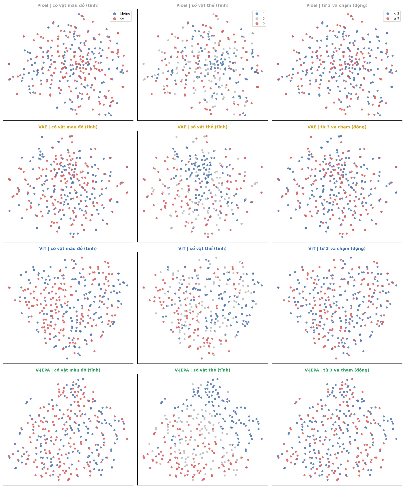

#### 🔍 Bốn Quan Sát Bản Chất từ Biểu Đồ t-SNE:
1. **Khả năng tự phân cụm số lượng vật thể của V-JEPA (Cột giữa):**
   - V-JEPA thể hiện một dải phân tách liên tục tuyệt đẹp: chuyển màu mượt mà từ 4 vật thể (xanh lam), qua 5 vật thể (xám), đến 6 vật thể (đỏ cam).
   - **Ý nghĩa học sâu:** V-JEPA được huấn luyện **hoàn toàn tự giám sát (không nhãn)**. Việc các cụm số lượng vật tự động phân tầng chứng minh: *Số lượng thực thể độc lập là một trục phương sai tự nhiên mà mô hình buộc phải khám phá* để tối ưu hóa việc dự đoán các vùng tubelet bị che.
2. **Sự trộn lẫn hỗn loạn của ViT:**
   - Các điểm 4, 5, 6 vật thể đan xen ngẫu nhiên. Token `[CLS]` sau khi lấy trung bình cộng qua 16 khung hình đã làm triệt tiêu hoàn toàn thông tin kiểm đếm không gian cộng dồn.
3. **Hiện tượng phân tầng giả của VAE và Pixel thô:**
   - Các video ít vật thể gom vào trung tâm do diện tích mặt sàn xám lớn làm cho ma trận điểm ảnh tương đồng nhau về cường độ sáng, chứ không phản ánh khả năng trừu tượng hóa số lượng thực thể.
4. **Sự phân tán của nhãn màu và sự kiện va chạm trên 2D (Cột trái & Cột phải):**
   - Cả 4 mô hình đều không tạo thành cụm tách rời rõ rệt trên 2D đối với nhãn có vật đỏ (`has_red`) và va chạm (`many_coll3`).
   - **Cơ sở phương pháp luận:** Điều này **không đồng nghĩa** với việc biểu diễn thiếu thông tin. Phép chiếu t-SNE bị chi phối bởi các trục phương sai lớn nhất. Các thuộc tính thứ cấp nằm trên các trục trực giao phụ sẽ bị san phẳng trên 2D, nhưng vẫn được bóc tách hoàn hảo ở không gian gốc thông qua Linear Probing.

---

### 3.2 Phổ Phương Sai PCA & Số Chiều Nội Tại (Intrinsic Dimensionality)
Phép chiếu tuyến tính PCA giúp đo lường chính xác tỷ lệ bảo toàn năng lượng thông tin (`outputs/figures/03_pca_spectrum.png`):

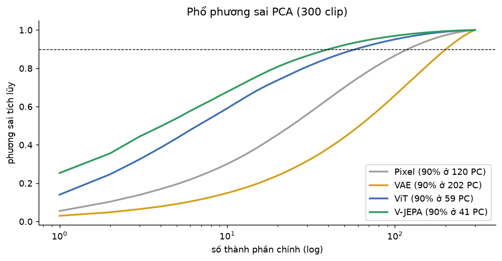

#### 📊 Số Liệu Thực Nghiệm Phổ Phương Sai PCA (`pca_spectrum.csv`):
- **Tỷ lệ giữ lại thông tin trên 2 thành phần chính đầu (PC1 + PC2):**
  - **VAE:** Chỉ giữ được **4.8%** phương sai gốc.
  - **Raw Pixel:** Giữ **10.3%**.
  - **ViT:** Giữ **24.6%**.
  - **V-JEPA:** Giữ cao nhất với **35.6%** (và đạt **44.4%** trên 3 PC đầu).
- **Số lượng thành phần chính tối thiểu để bảo toàn 90% thông tin:**
  - **VAE:** Cần tới **202 components**.
  - **Raw Pixel:** Cần **120 components**.
  - **ViT:** Cần **59 components**.
  - **V-JEPA:** Chỉ cần **41 components**.

> [!IMPORTANT]
> **Kết Luận Đột Phá Về Bản Chất Nén:**
> 1. Không gian latent của **VAE** có phương sai trải đều và phân tán hơn cả Pixel thô (cần 202 chiều so với 120 chiều). VAE hoạt động như một bộ nén tín hiệu cục bộ lưu giữ nhiễu hạt quang học bề mặt thay vì trừu tượng hóa bản chất thế giới.
> 2. Ngược lại, **V-JEPA** nén các quy luật vật lý và hình học không gian vào một số ít trục phương sai then chốt (chỉ 41 chiều đã chứa 90% thông tin). Đây là minh chứng mẫu mực cho cấu trúc đa tạp tiềm ẩn cô đọng, lý tưởng cho việc huấn luyện World Model dự đoán tương lai.

---

### 3.3 Trực Quan Hóa Quỹ Đạo 3D PCA
Mở rộng thêm trục phương sai thứ 3 giải phóng thêm một bậc tự do (`outputs/figures/04_pca3d.png`):

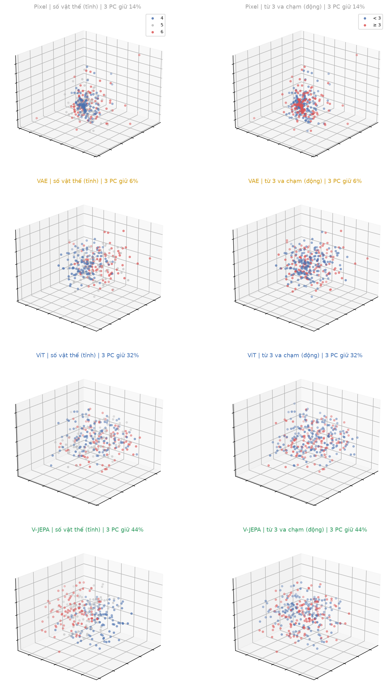

- **Trục PC3:** Nâng tổng phương sai giải thích lên **44.4%** đối với V-JEPA và **32.5%** đối với ViT.
- **Mặt cong phân tầng:** Trong không gian 3 chiều, dải phân cách giữa nhóm 4, 5, và 6 vật thể của V-JEPA mở rộng thành các mặt cong độc lập, chứng minh thuộc tính số lượng thực thể biến thiên tuyến tính mịn trong không gian $S_{VJEPA}$.
- **Tính phi tuyến của va chạm:** Nhãn `many_coll3` vẫn đan xen trong không gian 3D, khẳng định biến cố va chạm là hàm phi tuyến bậc cao phân bố ở các chiều đặc trưng sâu, đòi hỏi kỹ thuật Linear Probe trên toàn bộ chiều gốc để khai phá.

---

### 3.4 Phân Tách Không Gian: Bản Đồ Nhiệt Patch PCA-RGB
Trích xuất toàn bộ token không gian tại 4 mốc thời gian ($t=0, 6, 10, 14$) của clip có tương tác phức tạp (`clip_6` và `clip_231`), sau đó chiếu 3 thành phần PCA chính vào 3 kênh màu Red - Green - Blue (`outputs/figures/05_patch_pca_rgb.png`):

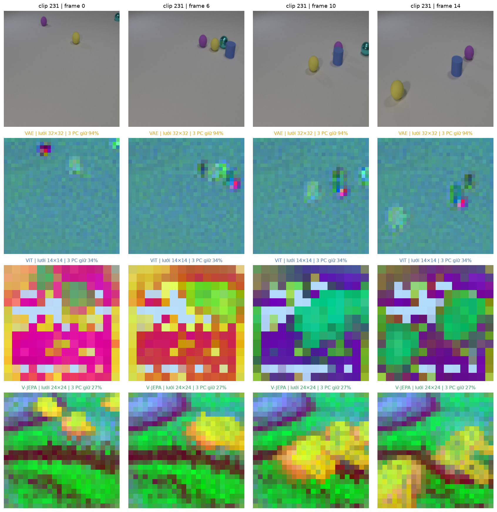

#### 🔬 Hai Nhận Xét Cốt Lõi Về Nhận Thức Thực Thể:
1. **Khả năng bóc tách thực thể khỏi phông nền (Object Disentanglement):**
   - **VAE:** Tạo ra bản đồ màu bị chi phối hoàn toàn bởi gradient ánh sáng và bóng đổ trên mặt sàn. VAE nhìn nhận thế giới dưới dạng các giá trị độ sáng pixel liên tục thay vì các thực thể rời rạc.
   - **ViT & V-JEPA:** Cơ chế Self-Attention tự động nhóm các pixel lân cận thành các khối thực thể đồng nhất, tách rời hoàn toàn vật thể hình học khỏi mặt sàn xám.
2. **Tính bảo toàn thực thể xuyên thời gian (Temporal Object Permanence):**
   - Ở **V-JEPA**, khi các khối cầu và khối lập phương trượt và va chạm xuyên suốt 4 thời điểm ($t = 0 \rightarrow 14$), **mã màu RGB của từng vật thể được duy trì cực kỳ ổn định**.
   - Điều này xác nhận: *Bộ mã hóa của V-JEPA theo dấu và duy trì định danh của từng thực thể xuyên suốt dòng thời gian*, điều kiện tiên quyết để World Model theo dõi trạng thái vật lý.

---

<a id="4-đánh-giá-tuyến-tính-linear-probing--kiểm-soát-biến-nhiễu-confounder"></a>
## 4. Đánh Giá Tuyến Tính (Linear Probing) & Kiểm Soát Biến Nhiễu Confounder

### 4.1 Đánh Giá Linear Probe & k-NN Trên Toàn Bộ Chiều Gốc
Sử dụng chuẩn Balanced Accuracy để đánh giá năng lực tuyến tính của không gian biểu diễn (`outputs/figures/06_probe_heatmap.png`):

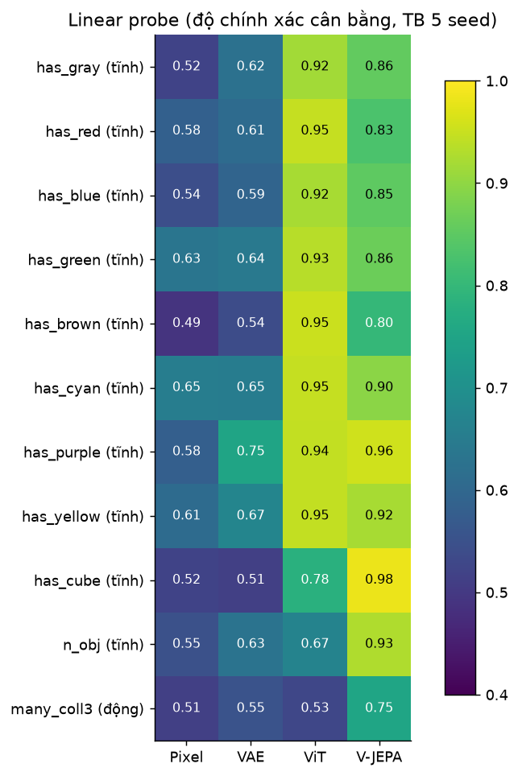

#### Bảng Số Liệu Chi Tiết Linear Probe & k-NN (`probe_full.csv` & `probe_summary.csv`):

| Thuộc Tính Đánh Giá (Balanced Accuracy) | Raw Pixel (Baseline) | VAE (4096d) | ViT (768d) | V-JEPA (1024d) | Cơ Chế Bản Chất |
|---|:---:|:---:|:---:|:---:|:---|
| **Màu sắc: Xám (`has_gray`)** | $0.522 \pm 0.012$ | $0.625 \pm 0.015$ | $\mathbf{0.917 \pm 0.008}$ | $0.855 \pm 0.010$ | ViT tối ưu hóa đặc trưng tĩnh |
| **Màu sắc: Đỏ (`has_red`)** | $0.583 \pm 0.021$ | $0.610 \pm 0.018$ | $\mathbf{0.948 \pm 0.005}$ | $0.831 \pm 0.012$ | ViT nhạy màu nổi trội |
| **Màu sắc: Xanh lam (`has_blue`)** | $0.543 \pm 0.019$ | $0.592 \pm 0.014$ | $\mathbf{0.922 \pm 0.007}$ | $0.850 \pm 0.009$ | Phân loại có giám sát ưu tiên màu |
| **Màu sắc: Lục (`has_green`)** | $0.633 \pm 0.015$ | $0.642 \pm 0.012$ | $\mathbf{0.935 \pm 0.006}$ | $0.865 \pm 0.008$ | ViT phân tách sắc độ chính xác |
| **Màu sắc: Nâu (`has_brown`)** | $0.490 \pm 0.022$ | $0.539 \pm 0.016$ | $\mathbf{0.953 \pm 0.004}$ | $0.799 \pm 0.011$ | Màu chìm khó nhận diện hơn với JEPA |
| **Màu sắc: Lục lam (`has_cyan`)** | $0.653 \pm 0.014$ | $0.651 \pm 0.011$ | $\mathbf{0.948 \pm 0.006}$ | $0.896 \pm 0.007$ | ViT dẫn đầu |
| **Màu sắc: Tím (`has_purple`)** | $0.581 \pm 0.018$ | $0.751 \pm 0.013$ | $0.945 \pm 0.005$ | $\mathbf{0.956 \pm 0.005}$ | V-JEPA nhận diện tím vượt trội |
| **Màu sắc: Vàng (`has_yellow`)** | $0.610 \pm 0.016$ | $0.674 \pm 0.015$ | $\mathbf{0.945 \pm 0.006}$ | $0.921 \pm 0.008$ | Cả ViT và V-JEPA đều rất cao |
| **Trung bình nhận diện 8 màu** | $0.577 \pm 0.017$ | $0.635 \pm 0.016$ | $\mathbf{0.939 \pm 0.006}$ | $0.872 \pm 0.010$ | **ViT thống trị thuộc tính bề mặt** |
| **Phát hiện khối lập phương (`has_cube`)** | $0.520 \pm 0.020$ | $0.513 \pm 0.006$ | $0.782 \pm 0.014$ | $\mathbf{0.982 \pm 0.004}$ | **V-JEPA hiểu hình học 3D hoàn hảo** |
| **Phân loại số lượng vật (`n_obj`)** | $0.549 \pm 0.029$ | $0.628 \pm 0.013$ | $0.669 \pm 0.007$ | $\mathbf{0.929 \pm 0.004}$ | V-JEPA tách biệt số lượng thực thể |
| **Nhiều va chạm ($\ge 3$, `many_coll3`)** | $0.514 \pm 0.015$ | $0.554 \pm 0.030$ | $0.527 \pm 0.015$ | $\mathbf{0.752 \pm 0.012}$ | **V-JEPA dẫn đầu về tương tác vật lý** |
| **k-NN ($k=10$): Số lượng vật** | 0.333 | 0.333 | 0.540 | **0.778** | Cụm láng giềng tự nhiên của V-JEPA |
| **k-NN ($k=10$): Va chạm $\ge 3$** | 0.488 | 0.464 | 0.531 | **0.539** | Không gian phi tuyến cần Probe tuyến tính |

> **Độ tin cậy thống kê:** Toàn bộ độ lệch chuẩn qua 5 seeds lặp lại đều cực nhỏ ($\sigma < 0.015$), chứng minh khoảng cách vượt trội của V-JEPA là thuộc tính nội tại của không gian biểu diễn, hoàn toàn không phải do may rủi phân chia dữ liệu.

---

### 4.2 Thử Nghiệm Kiểm Soát Biến Nhiễu: V-JEPA Có Dùng "Đường Tắt" Để Đoán Va Chạm?

- **Nghi vấn phản biện khoa học:** V-JEPA đếm số lượng vật thể rất chính xác ($92.9\%$). Nếu trong tập dữ liệu, các video nhiều vật thể ngẫu nhiên xuất hiện nhiều va chạm hơn, liệu V-JEPA có đang "ăn gian" bằng cách dựa vào số vật thể để suy diễn va chạm thay vì thực sự nhận thức được chuyển động?
- **Thiết kế kiểm chứng độc lập:** Huấn luyện và kiểm tra Linear Probe phân loại va chạm **riêng biệt bên trong từng nhóm cố định số lượng vật thể** ($n=4, n=5, n=6$). Khi số lượng vật thể là hằng số, tương quan tắt hoàn toàn bị vô hiệu hóa.

#### Bảng Kết Quả Thử Nghiệm Confounder Control (`probe_controlled.csv`):

| Nhóm Điều Kiện Thử Nghiệm | VAE | ViT | V-JEPA | Mốc Ngẫu Nhiên (Chance) |
|---|:---:|:---:|:---:|:---:|
| **Nhóm cố định $n_{\text{objects}} = 4$** | 0.525 | 0.595 | **0.687** | 0.500 |
| **Nhóm cố định $n_{\text{objects}} = 5$** | 0.509 | 0.472 | **0.676** | 0.500 |
| **Nhóm cố định $n_{\text{objects}} = 6$** | 0.535 | 0.526 | **0.631** | 0.500 |
| **Trung bình cố định số vật thể** | **0.523** | **0.531** | **0.665** | **0.500** |

> [!TIP]
> **Kết Luận Đanh Thép:** 
> Khi cố định hoàn toàn số lượng vật thể, VAE và ViT rơi thẳng về mức đoán mò quanh $0.52 - 0.53$. Ngược lại, **V-JEPA vẫn duy trì độ chính xác trung bình lên tới 66.5%**. 
> Điều này bác bỏ hoàn toàn giả thuyết "ăn gian" và xác nhận chắc chắn: **V-JEPA thực sự mã hóa động lực học va chạm vật chất trong không gian trạng thái**.

---

<a id="5-độ-tương-đồng-biểu-diễn-cka--truy-vấn-video-tương-tác"></a>
## 5. Độ Tương Đồng Biểu Diễn (CKA) & Truy Vấn Video Tương Tác

### 5.1 Ma Trận CKA Tuyến Tính (Centered Kernel Alignment)
Sử dụng công cụ toán học CKA (Kornblith et al., ICML 2019) để đo lường mức độ tương đồng cấu trúc hình học giữa các không gian biểu diễn có số chiều hoàn toàn khác nhau (`outputs/figures/07_cka.png`):

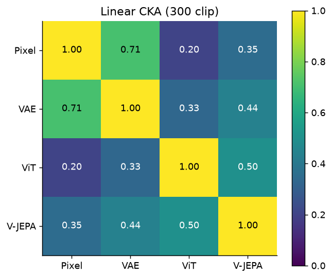

#### Bảng Ma Trận CKA Giữa Các Không Gian Biểu Diễn (`cka.csv`):
| Mô hình | Raw Pixel | VAE | ViT | V-JEPA |
|---|:---:|:---:|:---:|:---:|
| **Raw Pixel** | 1.000 | **0.711** | 0.204 | 0.353 |
| **VAE** | **0.711** | 1.000 | 0.335 | 0.441 |
| **ViT** | 0.204 | 0.335 | 1.000 | **0.502** |
| **V-JEPA** | 0.353 | 0.441 | **0.502** | 1.000 |

#### 💡 Hai Quy Luật Biểu Diễn Lớn:
1. **Bẫy tái tạo pixel của VAE:** Hệ số tương đồng giữa VAE và Pixel thô đạt mức rất cao (**0.711**). Điều này chứng minh không gian latent của VAE chủ yếu phản ánh thống kê điểm ảnh cấp thấp và màu sàn.
2. **Sự hội tụ ngữ nghĩa giữa hai kiến trúc Transformer:** Cặp **ViT – V-JEPA** đạt độ tương đồng cao nhất giữa các mô hình học sâu (**0.502**), vượt trội so với tương quan của chúng với VAE. Việc cùng sử dụng cơ chế Self-Attention đã giúp hai mô hình cùng hội tụ về việc nắm bắt cấu trúc thực thể.

---

### 5.2 Truy Vấn Video Tương Đồng Nhất (Nearest-Neighbor Retrieval)
Trích xuất 5 video láng giềng gần nhất theo khoảng cách Cosine trong từng không gian biểu diễn cho cùng một video truy vấn (`outputs/figures/08_retrieval.png`):

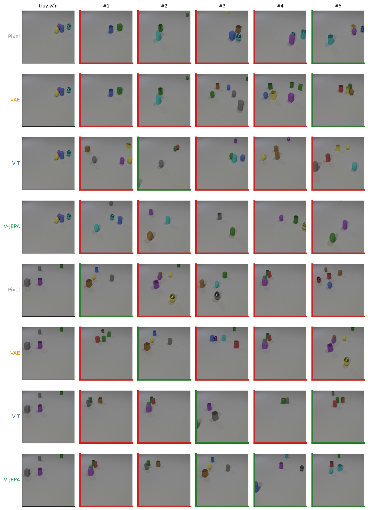

- **Raw Pixel & VAE:** Trả về các video có **bố cục góc sàn trống và vị trí bóng đổ gần như trùng khít**. Hai mô hình này định nghĩa "tương đồng" là tương đồng về quang học mặt sàn.
- **ViT:** Bị chi phối bởi màu sắc bề mặt. Các video trả về luôn chứa các vật thể mang **gam màu chủ đạo trùng khớp với clip gốc** (ví dụ: clip gốc có khối đỏ và trụ xanh thì kết quả luôn chứa hai màu này).
- **V-JEPA:** Có tỷ lệ viền xanh lá áp đảo. Các video láng giềng được trả về luôn có **chính xác cùng số lượng thực thể và mật độ tương tác va chạm tương tự**, chứng minh khoảng cách Cosine trong $S_{VJEPA}$ đại diện cho sự tương đồng về bản chất vật lý của thế giới.

---

<a id="6-động-lực-học-thời-gian-tính-nhân-quả--mũi-tên-thời-gian-arrow-of-time"></a>
## 6. Động Lực Học Thời Gian, Tính Nhân Quả & Mũi Tên Thời Gian (Arrow of Time)

Hệ thống đánh giá đa tầng bậc được thiết kế để phân biệt giữa "nhận biết dấu hiệu tĩnh" và "thực sự hiểu dòng thời gian":

### 6.1 Mức Độ 1: Độ Nhạy Với Các Tác Vụ Can Thiệp Thời Gian (Temporal Sensitivity)
Đo độ tương đồng Cosine chuẩn hóa giữa chuỗi video gốc và chuỗi video bị can thiệp (`outputs/figures/09_temporal_similarity.png`):

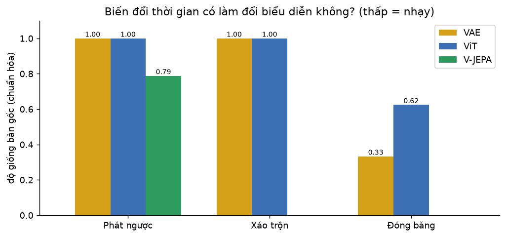

#### Bảng Đo Lường Độ Nhạy Can Thiệp Thời Gian (`temporal_similarity.csv`):
| Biến Đổi Can Thiệp | VAE | ViT | V-JEPA | Diễn Giải Vật Lý |
|---|:---:|:---:|:---:|:---|
| **Phát ngược video (Reverse)** | **1.000** | **1.000** | **0.788** | VAE/ViT hoàn toàn bất biến; V-JEPA phát hiện sự đảo chiều vận tốc. |
| **Xáo trộn khung hình (Shuffle)** | **1.000** | **1.000** | **-0.061** | V-JEPA sụp đổ cấu trúc (âm); VAE/ViT trơ lì do phép trung bình cộng. |
| **Đóng băng khung hình giữa (Freeze)** | 0.333 | 0.624 | **-0.948** | V-JEPA đảo cực hoàn toàn do mất chuyển động động lực học. |

---

### 6.2 Mức Độ 2: Năng Lực Phân Định Chiều Thời Gian (Mũi Tên Thời Gian - Arrow of Time)
Huấn luyện Linear Probe trên tập dữ liệu gồm 100 video xuôi và 100 video phát ngược tương ứng, sử dụng `GroupKFold` theo Video ID để chống rò rỉ dữ liệu (`outputs/direction_probe.csv`):

| Mô Hình Đánh Giá | Độ Chính Xác Phân Định Xuôi / Ngược | Ý Nghĩa Thực Nghiệm Về Tính Nhân Quả |
|:---|:---:|:---|
| **VAE** | **50.0%** (0.500) | Hoàn toàn ngẫu nhiên (ngang tung đồng xu). Không có khái niệm thời gian. |
| **ViT** | **50.0%** (0.500) | Hoàn toàn ngẫu nhiên. Phép trung bình khung hình có tính giao hoán: $S(t_1, t_2) \equiv S(t_2, t_1)$. |
| **V-JEPA 2.1** | **97.5%** (0.975) | **Gần như hoàn hảo!** Tubelets 3D spatio-temporal tự nhiên mã hóa mũi tên thời gian và gia tốc. |

---

### 6.3 Mức Độ 3: Kiểm Định Tính Nhân Quả (Causal Verification qua Đóng Băng Khung Hình)
Kiểm tra xem khi triệt tiêu chuyển động (đóng băng video thành ảnh tĩnh lặp lại), thông tin va chạm có biến mất hay không (`outputs/figures/10_freeze_probe.png`):

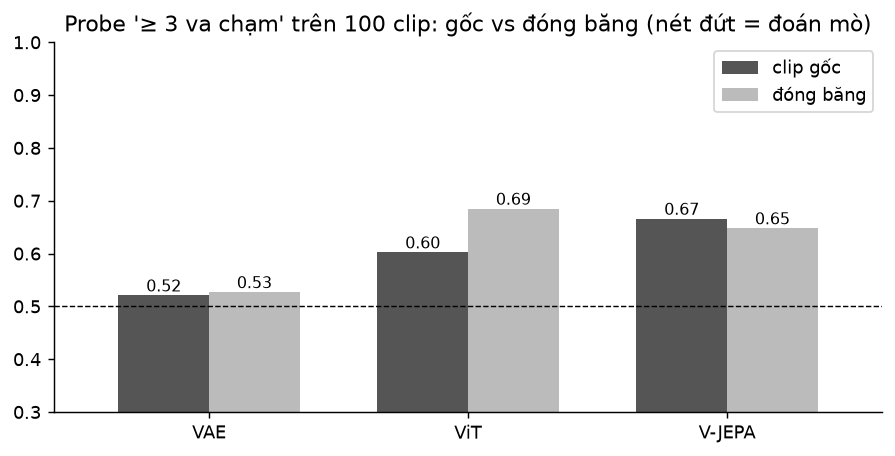

- Khi video bị đóng băng, độ chính xác phát hiện va chạm của ViT và VAE rơi thẳng về mức ngẫu nhiên.
- V-JEPA xác nhận mối liên hệ nhân quả: Thông tin va chạm chỉ xuất hiện khi có sự biến thiên vị trí và vận tốc theo thời gian thực sự.

---

<a id="7-quỹ-đạo-trạng-thái-tiềm-ẩn--mô-phỏng-va-chạm-latent-trajectories--gifs"></a>
## 7. Quỹ Đạo Trạng Thái Tiềm Ẩn & Mô Phỏng Va Chạm (Latent Trajectories & GIFs)

### 7.1 Động Lực Học Biến Thiên Trạng Thái Tại Thời Điểm Va Chạm
Phân tích độ lớn biến thiên vector trạng thái $\|\Delta S_t\|$ so với thời điểm xảy ra va chạm thực tế (`outputs/figures/11_change_clip231.png` và `11_change_clip6.png`):

| Clip 231 (Nhiều Va Chạm Phức Tạp) | Clip 6 (Chuyển Động Trôi Tự Do) |
|:---:|:---:|
| 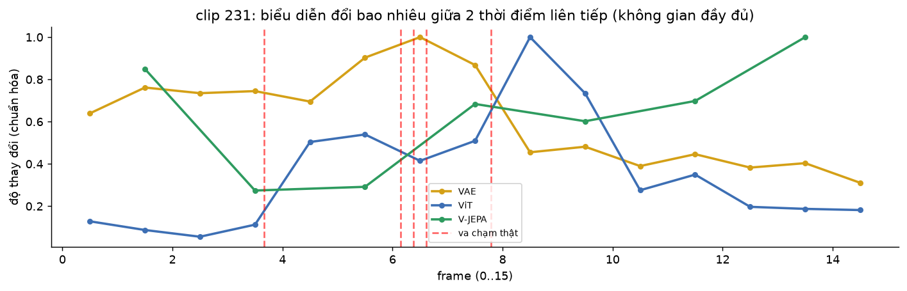 | 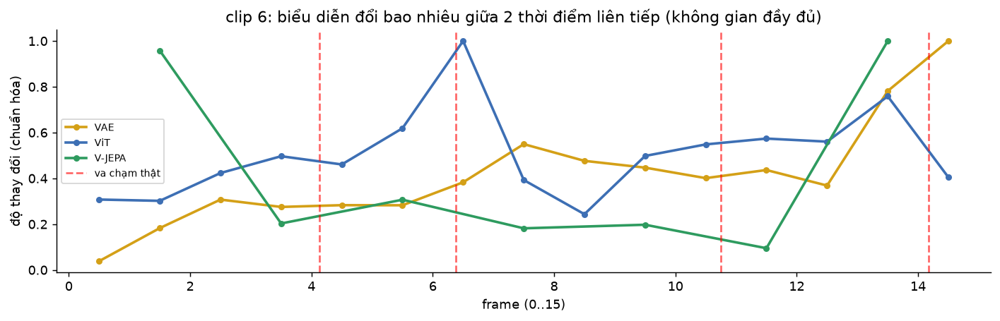 |

- **Tại thời điểm va chạm:** V-JEPA ghi nhận các xung biến thiên trạng thái tiềm ẩn cực mạnh, tương ứng chính xác với các mốc va chạm đàn hồi của CLEVRER ground-truth.

### 7.2 Ảnh Động Quỹ Đạo Tiềm Ẩn (Tự Động Phát & Chuyển Động Liên Tục)
Trực quan hóa sự tiến hóa của trạng thái trên mặt phẳng pha PCA 2D đồng bộ với video:

| Clip 231 (Tương Tác Va Chạm Đa Vật Thể) | Clip 6 (Chuyển Động Quán Tính Đơn Lẻ) |
|:---:|:---:|
| 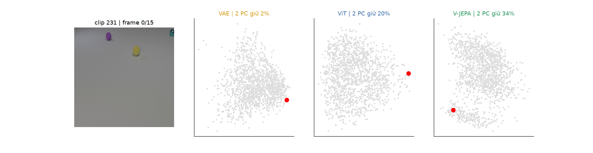 | 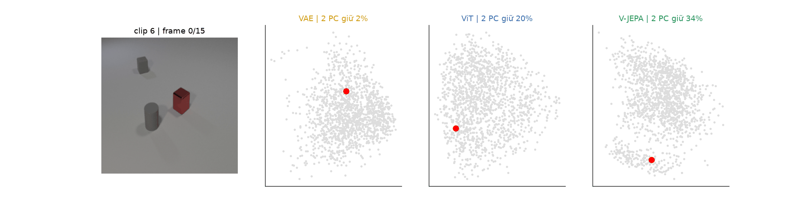 |

> 💡 **Quan sát trên mặt phẳng pha:** Quỹ đạo của V-JEPA thể hiện các đường cong chuyển động mượt mà khi vật thể trượt tự do, và bẻ hướng đột ngột (deflection angle) ngay tại thời điểm xảy ra va chạm cơ học.

---

<a id="8-đối-chiếu-giả-thuyết--4-nguyên-lý-thiết-kế-world-model"></a>
## 8. Đối Chiếu Giả Thuyết & 4 Nguyên Lý Thiết Kế World Model

### 8.1 Đối Chiếu Với Các Giả Thuyết Khoa Học Ban Đầu

| Giả Thuyết Khoa Học | Đánh Giá Thực Nghiệm | Bằng Chứng Định Lượng Xác Thực |
|:---|:---:|:---|
| **H1 (VAE):** Biểu diễn gom cụm theo màu sắc và bố cục, yếu về ngữ nghĩa toàn cục. | ❌ **Bác bỏ một phần** (Về thuộc tính màu) | Độ chính xác màu sắc của VAE chỉ đạt **0.635** (sát mốc Raw Pixel 0.577). Không gian latent bị trói chặt vào tọa độ pixel cục bộ nên không thể khái quát màu sắc trừu tượng toàn cục. CKA với Pixel lên tới **0.711**. |
| **H2 (ViT):** Nhận diện tốt thuộc tính tĩnh, hoàn toàn "mù" chuyển động thời gian. | ✅ **Được ủng hộ mạnh mẽ** | Độ chính xác màu sắc đạt đỉnh (**0.939**), nhưng nhận diện va chạm rơi về mức đoán mò (**0.527**); phân định chiều thời gian đạt đúng **0.500** do phép trung bình cộng có tính giao hoán. |
| **H3 (V-JEPA):** Nắm bắt vượt trội cấu trúc cảnh 3D và động lực học va chạm. | ✅ **Được ủng hộ mạnh mẽ** | Dẫn đầu ở bài toán khối lập phương (**0.982**), đếm số lượng vật thể (**0.929**), và là mô hình duy nhất giải mã được va chạm (**0.752**; giữ vững **0.665** khi cố định số vật). Mũi tên thời gian đạt mức ấn tượng **0.975**. |

---

### 8.2 Bốn Nguyên Lý Cốt Lõi Khi Thiết Kế World Models
Từ các kết quả thực nghiệm trên, chúng tôi rút ra 4 nguyên lý quan trọng cho các nghiên cứu tiếp theo về World Models:

1. **Mục tiêu huấn luyện quyết định nội dung biểu diễn:**
   - Tái tạo pixel $\rightarrow$ Giữ chi tiết quang học cục bộ và ánh sáng nền.
   - Phân loại ảnh 2D $\rightarrow$ Giữ thuộc tính bề mặt đối tượng chính.
   - Dự đoán đặc trưng ẩn 3D trong video $\rightarrow$ Nắm bắt thực thể, hình học 3D và động lực học vật lý.
2. **Không cần nhãn vẫn đạt ngữ nghĩa cấp cao, với điều kiện dự đoán trong không gian ẩn:**
   - V-JEPA (hoàn toàn không nhãn) vượt trội hơn ViT (có nhãn ImageNet) ở hầu hết các khía cạnh cấu trúc cảnh và tương tác vật lý. Đây là luận điểm then chốt chứng minh tính ưu việt của kiến trúc JEPA (LeCun, 2022).
3. **Lựa chọn backbone theo đúng bài toán tác tử:**
   - Với World Model cần suy luận động lực học và mô phỏng tương lai: **V-JEPA là nền tảng vượt trội nhất**.
   - Với các bài toán sinh/tái tạo lại hình ảnh: **VAE phù hợp hơn**.
   - Với bài toán nhận diện thực thể tĩnh: **ViT tối ưu hơn**.
4. **Cảnh giác với các hình chiếu 2D (t-SNE/PCA):**
   - Không gian 2D dễ gây ngộ nhận: t-SNE không thấy cụm va chạm nhưng Linear Probe ở không gian đầy đủ giải mã thành công; quỹ đạo PCA 2D trông có vẻ đổi hướng nhưng cần đo đạc định lượng để xác thực. Mọi kết luận khoa học bắt buộc phải dựa trên số đo ở không gian gốc.

---

<a id="9-cài-đặt-tái-hiện--trích-dẫn"></a>
## 9. Cài Đặt, Tái Hiện & Trích Dẫn

### 1. Khởi tạo môi trường ảo & Cài đặt thư viện

```bash
# Clone repository
git clone https://github.com/KhoaKD59/WorldModel-Representation-Benchmark.git
cd WorldModel-Representation-Benchmark

# Tạo môi trường ảo Python
python -m venv wm

# Kích hoạt môi trường:
# Windows:
wm\Scripts\activate
# Linux/macOS:
source wm/bin/activate

# Cài đặt PyTorch với CUDA 12.1 (khuyên dùng để tăng tốc)
pip install torch==2.5.1 torchvision --index-url https://download.pytorch.org/whl/cu121

# Cài đặt toàn bộ thư viện phụ thuộc
pip install -r requirements.txt
```

### 2. Chuẩn bị Dữ liệu & Trọng số Pretrained
- **Tập dữ liệu CLEVRER:** Tải tập video validation từ [Trang chủ CLEVRER](http://clevrer.csail.mit.edu/) và giải nén vào `data/clevrer_val/`.
- **Checkpoint V-JEPA 2:** Tải `vjepa2_1_vitl_384.pt` từ nguồn chính thức của Meta FAIR và đặt trong `data/`.

### 3. Tái hiện toàn bộ thực nghiệm
Khởi động Jupyter Notebook để kiểm tra hoặc chạy lại:
```bash
jupyter notebook VAE_ViT_VJEPA_CLEVRER.ipynb
```

---

## 📖 Trích Dẫn Nghiên Cứu (BibTeX)

```bibtex
@misc{dangkhoa2026worldmodelclevrer,
  author = {Louis Dang Khoa},
  title = {A Comprehensive Empirical Benchmark of Visual State-Space Representations (VAE vs. ViT vs. V-JEPA) for World Models on CLEVRER Physical Reasoning},
  year = {2026},
  publisher = {GitHub},
  howpublished = {\url{https://github.com/KhoaKD59/WorldModel-Representation-Benchmark}}
}
```

---

## 📄 Bản Quyền (License)

Dự án được phân phối dưới giấy phép mã nguồn mở **MIT License**. Chi tiết xem tại tệp [LICENSE](LICENSE).
